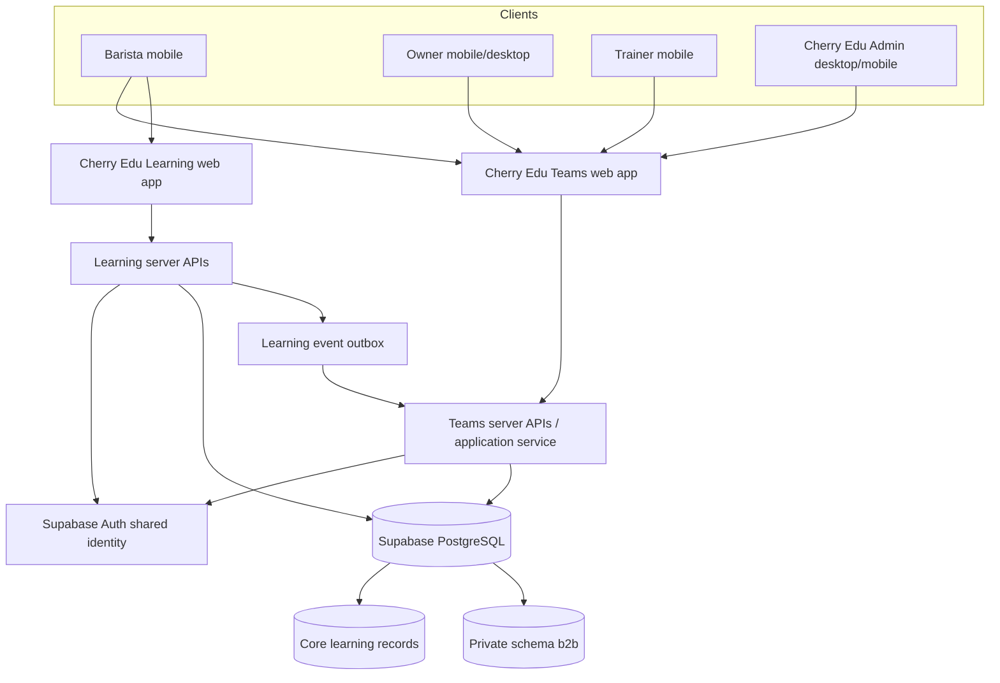
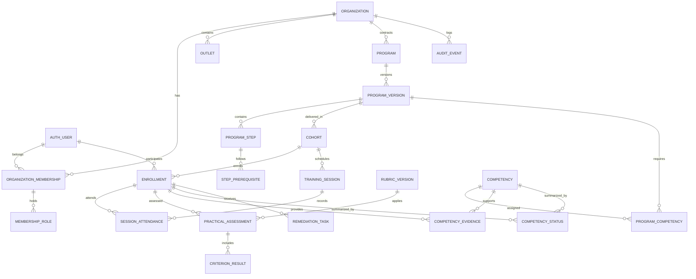
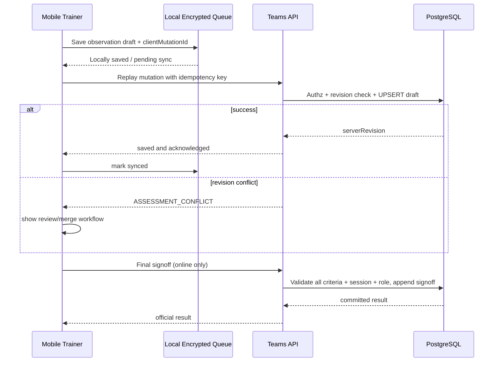

# CHERRY EDU TEAMS — MASTER HANDOVER / PRODUCT BLUEPRINT v1.1

**Tanggal:** 13 Oktober 2026  
**Status:** perencanaan produk & spesifikasi UI; **bukan implementasi**  
**Perubahan terbaru:** instruksi visual dari pemilik produk menjadi **hard constraints**: tidak ada glow hijau neon, merah terang acak, pill tanpa fungsi; ikuti brand color Cherry Edu yang disetujui dan desain tenang, sederhana serta mobile-friendly.

Paket ini menggabungkan seluruh dokumen canonical secara utuh, tanpa meringkas isi tiap file. **Tidak ada modifikasi repo, database, atau deployment production.**

## Daftar isi

1. Bagian 1 — UX & Service Blueprint — `01_UX_Service_Blueprint.md`
2. Bagian 2 — Product Requirements Document — `02_PRD.md`
3. Bagian 3 — ERD & Technical Architecture — `03_ERD_Technical_Architecture.md`
4. Bagian 4 — Engineering Handover — `04_Antigravity_Engineering_Handover.md`
5. Bagian 5 — UI Art Direction & Visual Guardrails — `05_UI_Visual_Direction_Guardrails.md`
6. Bagian 6 — Package README / Changelog — `README.md`

---


---

# Bagian 1 — UX & Service Blueprint

# Cherry Edu Teams — UX & Service Blueprint v1.1

**Tanggal:** 13 Oktober 2026  
**Status:** Product design baseline untuk validasi, bukan bukti usability test  
**Bahasa UI:** Indonesia (default); i18n-ready  
**Sasaran:** barista, pemilik coffee shop, trainer Cherry Edu, admin Cherry Edu  
**Platform:** responsive web/PWA; mobile-first untuk barista, owner, trainer  
**Hubungan produk:** Cherry Edu Learning (B2C) ↔ Cherry Edu Teams (B2B)

## 0. Ringkasan keputusan

Cherry Edu Teams adalah tempat *menjalankan* layanan peningkatan kemampuan tim coffee shop. Materi bisa berasal dari Foundation Path, Barista Path, serta SOP dan tugas buatan Cherry Edu/klien. Platform belajar utama tetap berfungsi sebagai penyedia konten; B2B mengelola assignment, kehadiran, praktik, penilaian kompetensi dan pelaporan.

**Janji UX per persona:**
- Barista: "Apa yang harus aku pelajari/latih berikutnya?"
- Owner: "Siapa yang sudah siap dan siapa yang perlu dibantu?"
- Trainer: "Apa yang harus aku nilai sekarang, dengan bukti apa?"
- Admin: "Bagaimana membuat dan menjalankan program klien tanpa pekerjaan berulang?"

**Jangan lakukan:** satu dashboard generik untuk semua role; persen tunggal untuk kesiapan kerja; nilai kompetensi otomatis hanya dari kuis; leaderboard performa karyawan; UI yang penuh label internal, placeholder, "draft", "coming soon", atau teks teknis.

## 1. Service blueprint end-to-end

| Fase | Customer-facing | Backstage Cherry Edu | Sistem/data | Recovery penting |
|---|---|---|---|---|
| Discovery | Owner membahas masalah dan tujuan tim | Sales/trainer memetakan kebutuhan | Intake + kebutuhan kompetensi | Kebutuhan belum pasti → program belum diaktivasi |
| Kontrak/aktivasi | Owner menerima informasi layanan | Admin memverifikasi ruang lingkup | Status tenant: setup → active | Kontrak tertunda → akun owner boleh masuk ke halaman informasi terbatas |
| Setup | Owner menerima invite | Admin membuat organisasi, outlet, program dari template | Provisioning idempotent, domain/slug unik | Invite salah → batalkan/kirim ulang |
| Asesmen awal | Barista menyelesaikan diagnosis teori dan praktik | Trainer mengobservasi baseline | Baseline per kompetensi & rubric version | Absen → reschedule, bukan gagal |
| Learning plan | Barista melihat kegiatan pribadi | Admin/trainer menyetujui penempatan | Enrollment + exemptions sesuai bukti | Perubahan program → versi baru, progres lama aman |
| Online learning | Barista membaca dan mengerjakan kuis | Cherry Edu mengelola konten | Canonical learning events → B2B projection | Putus koneksi → indikator progres belum tersinkron |
| Offline session | Peserta mengikuti pelatihan | Trainer menilai dan mencatat kehadiran | Attendance + observations + signoff | Trainer offline → local pending, konflik ditangani |
| Remedial | Barista mendapat latihan spesifik | Trainer menetapkan tindak lanjut | Task, due date, evidence, reassessment | Perubahan jadwal / keterlambatan diberi alasan |
| Pelaporan | Owner membaca ringkasan dan tindakan | Account manager meninjau hasil | Competency aggregate, laporan periode | Data belum lengkap → tampil eksplisit, bukan disamarkan 0% |
| Renewal | Owner memilih tindak lanjut | Cherry Edu mengusulkan program berikutnya | Program history, skill-gap trends | Tidak renew → akses sesuai kontrak, data retained sesuai kebijakan |

**Frontstage/backstage boundary:** barista tidak melihat catatan kerja internal sales, margin kontrak, komentar privat antartim Cherry Edu, atau nilai barista lain. Owner hanya melihat progres dan hasil B2B sesuai persetujuan; bukan seluruh histori B2C pribadi.

## 2. Information architecture

### 2.1 Barista
- **Beranda:** "Lanjutkan", status terdekat, jadwal berikutnya, umpan balik terbaru.
- **Belajar:** urutan tahapan program, kegiatan tersedia/terkunci, "Referensi cepat" terpisah.
- **Progres:** kompetensi, umpan balik, riwayat evaluasi, pencapaian.
- Profil: akun, organisasi aktif, bantuan, privasi, pengaturan.

### 2.2 Owner
- **Ringkasan:** kesiapan tim; peringatan; aksi yang harus dilakukan.
- **Tim:** daftar orang, filter outlet, detail peserta.
- **Program:** tahap pelatihan, jadwal, agenda, penanggung jawab.
- **Laporan:** perubahan keterampilan, evidence summary, ekspor PDF/CSV (hak terbatas).

### 2.3 Trainer
- **Hari ini:** sesi berikutnya, peserta yang perlu dinilai, penilaian tertunda.
- **Sesi:** jadwal, check-in, daftar peserta.
- **Penilaian:** rubrik, catatan, pending signoff, remedial.
- Profil: penugasan lintas klien, status sinkronisasi, bantuan.

### 2.4 Admin Cherry Edu
- **Klien:** pencarian dan organisasi, detail kontrak/status dasar (tanpa invoicing kompleks MVP).
- **Program:** pustaka template, versi, assignment.
- **Operasional:** trainer, sesi, invite, anomali, rekonsiliasi.
- **Laporan:** antar-klien teragregasi dengan izin yang benar.
- Settings: user access, audit, data retention, integrations.

## 3. Screen inventory + prioritas

`P0` = wajib pilot; `P1` = rilis berikut; `P2` = pertimbangkan.

| ID | Role | Layar | P | Tujuan utama | CTA utama |
|---|---|---|---|---|---|
| AUTH-01 | Semua | Accept invitation | P0 | Validasi undangan & identitas | Masuk dengan Google/email |
| AUTH-02 | Semua | Switch organization/role | P0 | Konteks bisnis yang jelas | Masuk ke workspace |
| BAR-01 | Barista | Home | P0 | Ketahui kegiatan berikutnya | Lanjutkan belajar |
| BAR-02 | Barista | Program roadmap | P0 | Mengerti urutan dan gate | Buka tahap |
| BAR-03 | Barista | Learning handoff | P0 | Akses langsung materi Cherry Edu | Buka materi |
| BAR-04 | Barista | Quiz checkpoint | P0 | Pahami persyaratan & hasil | Mulai / ulangi |
| BAR-05 | Barista | Practical assessment status | P0 | Tahu apa yang menunggu trainer | Lihat jadwal/hasil |
| BAR-06 | Barista | Competency profile | P0 | Lihat penguasaan dan feedback | Lihat detail kompetensi |
| BAR-07 | Barista | Reference quick access | P1 | SOP saat bekerja | Buka panduan |
| OWN-01 | Owner | Overview | P0 | Kondisi kesiapan tim | Lihat yang perlu dibantu |
| OWN-02 | Owner | Team list | P0 | Temukan barista & status | Buka barista |
| OWN-03 | Owner | Staff detail | P0 | Lihat progress, evidence, blocker | Tindak lanjuti |
| OWN-04 | Owner | Skill-gap by outlet | P0 | Prioritas pelatihan | Lihat area pengembangan |
| OWN-05 | Owner | Program schedule | P0 | Pahami sesi dan tenggat | Detail sesi |
| OWN-06 | Owner | Report export | P1 | Ringkasan untuk manajemen | Unduh laporan |
| TRN-01 | Trainer | Today | P0 | Sesi & pekerjaan penilaian | Mulai sesi |
| TRN-02 | Trainer | Session roster | P0 | Kehadiran dan peserta | Tandai kehadiran |
| TRN-03 | Trainer | Practical rubric | P0 | Menilai per kriteria | Simpan penilaian |
| TRN-04 | Trainer | Signoff and remediation | P0 | Finalisasi / tindak lanjut | Konfirmasi hasil |
| TRN-05 | Trainer | Offline sync queue | P0 | Lihat pending/conflict | Sinkronkan/tinjau |
| ADM-01 | Admin | Client list | P0 | Kelola tenant | Tambah klien |
| ADM-02 | Admin | Client setup wizard | P0 | Provision tenant | Aktifkan program |
| ADM-03 | Admin | Program composer | P0 | Gabungkan materi & praktik | Simpan versi program |
| ADM-04 | Admin | Invite/import manager | P0 | Undang dan kelola peserta | Kirim undangan |
| ADM-05 | Admin | Session planner | P0 | Atur trainer dan peserta | Terbitkan jadwal |
| ADM-06 | Admin | Operations dashboard | P0 | Periksa blocker/data sync | Periksa anomali |
| ADM-07 | Admin | Rubric library | P1 | Template penilaian | Publikasikan versi |
| ADM-08 | Admin | Audit history | P0 | Telusur perubahan sensitif | Lihat kejadian |

## 4. Mobile layout — struktur, bukan desain final

### 4.1 BAR-01 Home — hirarki satu scroll

```text
┌───────────────────────────────────┐
│ Cherry Edu Teams       [Profil]   │
│ Halo, Raka                        │
│ Coffee Shop A · Barista           │
├───────────────────────────────────┤
│ LANJUTKAN                         │
│ Espresso: memahami variabel       │
│ 7 menit estimasi                  │
│ [ Lanjutkan belajar            →] │
├───────────────────────────────────┤
│ HAL YANG PERLU KAMU LAKUKAN       │
│ • 1 kuis perlu diselesaikan       │
│ • Praktik: menunggu jadwal        │
├───────────────────────────────────┤
│ Program kamu             [Lihat]  │
│ Foundation · tahap 3 dari 7       │
│ Barista · belum dimulai           │
├───────────────────────────────────┤
│ Beranda       Belajar     Progres │
└───────────────────────────────────┘
```

**Interaction notes:** CTA belajar mengarah ke *exact lesson*, bukan katalog. Jika user baru belum ada enrollment: empty state informatif "Program pelatihanmu sedang disiapkan" dengan kontak yang relevan. Jika user enrolled tetapi belum mulai: CTA "Mulai asesmen awal". Jika practice belum dijadwalkan: jangan beri tombol "Mulai praktik" yang tak dapat digunakan.

### 4.2 BAR-02 Learning roadmap

Tampilan berbentuk vertikal stepper; untuk setiap tahap tampil **status, judul, aksi berikutnya**. Detail dapat diperluas satu tahap per waktu. Gate menyebut persyaratan konkret: "Selesaikan kuis ekstraksi" atau "Menunggu trainer menilai praktik", bukan sekadar ikon gembok tanpa penjelasan. `optional` selalu diberi label "Pelengkap", tak dihitung sebagai blocker.

### 4.3 OWN-01 Owner overview

```text
┌───────────────────────────────────┐
│ Kopi Ruang             [Outlet ▾] │
│ Kondisi tim                       │
├───────────────────────────────────┤
│ 8 peserta aktif                   │
│ 5 memenuhi seluruh kompetensi     │
│ wajib pada tahapnya              │
├───────────────────────────────────┤
│ PERLU DITINDAKLANJUTI            │
│ • 2 menunggu observasi praktik   │
│ • 1 butuh remedial milk steaming  │
│ [Lihat peserta]                   │
├───────────────────────────────────┤
│ Tim                               │
│ Raka    Menunggu penilaian        │
│ Dina    Kompeten                  │
│ Fajar   Perlu latihan             │
├───────────────────────────────────┤
│ Ringkasan Tim Program Laporan     │
└───────────────────────────────────┘
```

**Aturan:** angka "kompeten" mempunyai denominator dan definisi yang dapat dibuka. "Belum dinilai" berbeda dari "belum kompeten". Status tak boleh dihitung dari kehadiran saja. Owner tidak diberi akses pada jawaban kuis pribadi yang tidak menjadi bagian kontrak/program.

### 4.4 TRN-03 Practical rubric

```text
┌───────────────────────────────────┐
│ < Kembali    Espresso Dial-in     │
│ Raka    2 dari 6 peserta          │
├───────────────────────────────────┤
│ Kriteria 1 dari 4                 │
│ Mengidentifikasi variabel masalah │
│                                   │
│ ( ) Belum mampu                   │
│ ( ) Banyak arahan                 │
│ (•) Sedikit arahan                │
│ ( ) Mandiri & konsisten          │
│                                   │
│ [Catatan temuan]                  │
│ ☐ Kesalahan kritis teramati      │
├───────────────────────────────────┤
│ Tersimpan lokal • Belum sinkron  │
│ [Simpan]             [Berikutnya] │
└───────────────────────────────────┘
```

**Aturan:** penilaian mempunyai rubric anchor yang bisa dibuka; catatan wajib jika tidak kompeten/kesalahan kritis; validasi final memerlukan internet; draft lokal tidak boleh ditampilkan sebagai hasil resmi. Tombol hanya aktif bila seluruh kriteria wajib terisi.

### 4.5 ADM-02 Client setup wizard (desktop-first, mobile usable)

1. Identitas dan kontak bisnis — cek nama mirip dan slug bentrok.
2. Outlet — satu default; boleh tambah nanti.
3. Program — template / program baru; pratinjau syllabus & gates.
4. Orang — owner, barista, trainer; invite CSV/manual; validasi duplikasi.
5. Jadwal — optional; dapat diatur setelah aktivasi.
6. Review — ringkasan akses dan tindakan aktivasi yang akan terjadi.

Draft setup disimpan sebagai operasi admin internal. Label "draft" boleh di workspace internal admin, **tidak** untuk learner/owner. Setelah submit, server melakukan provisioning idempotent; jangan menampilkan "berhasil" sebelum transaksi selesai.

## 5. Screen state matrix — wajib seluruh P0

Setiap screen harus diimplementasikan pada state berikut, bukan hanya happy path:

| State | Tampilan | Perilaku |
|---|---|---|
| Loading | Skeleton stabil proporsi konten | Hindari content jumping, tombol tidak bisa diklik ganda |
| Empty initial | Penjelasan singkat dan satu CTA relevan | Tidak memakai "No data" teknis |
| Empty filtered | "Tidak ada hasil untuk filter ini" | Reset filter tersedia |
| Partial data | Bagian valid tetap tampil, bagian gagal diberi status | Jangan mengganti angka dengan 0 jika belum berhasil dimuat |
| Network offline | Banner halus "Koneksi terputus" | Materi cached boleh dibaca; asesmen final tidak bisa disahkan |
| Pending sync | Penanda jelas serta jumlah item | Data lokal belum dianggap diterima server |
| Sync conflict | Penjelasan spesifik; pilih tindakan atau minta review | Jangan silent last-write-wins untuk asesmen |
| Unauthorized | "Kamu tidak punya akses ke halaman ini" | Jangan bocorkan nama/data tenant lain |
| Expired invite | Bisa minta undangan baru melalui kontak atau proses aman | Tidak memvalidasi lewat email query tanpa token |
| Inactive membership | Akses workspace ditutup | Akun Cherry Edu pribadi tetap ada |
| Validation error | Inline di field + ringkasan bila panjang | Input lainnya tetap tersimpan |
| Server error | Pesan manusiawi + retry aman | Operasi idempotent tak terduplikasi |
| Program suspended | Akses sesuai kebijakan kontrak | Status dan kontak jelas |
| Program completed | Ringkasan hasil dan rekomendasi | Bukan sekadar perayaan berlebihan |

**Copy contoh:**
- "Penilaian belum tersimpan ke server. Tetap di halaman ini atau coba sinkronkan saat koneksi kembali."
- "Sesi praktik belum dijadwalkan. Kamu tetap bisa mempelajari materi yang tersedia."
- "Nilaimu sudah tercatat. Trainer masih perlu memvalidasi praktik."
- "Hasil belum tersedia" (bukan "0%" saat data belum masuk).

## 6. Motion, interaction, ergonomi

- Scroll satu kolom untuk mayoritas mobile; tabel lebar menjadi daftar item stacked, bukan horizontal-scroll default.
- Primary touch target rekomendasi produk >=44–48 CSS px; spacing antartarget cukup untuk jari saat bekerja. Ini target desain internal, bukan kutipan literal WCAG.
- Minimum 16px untuk body utama (teks pendukung jangan terlalu kecil); layout reflow pada 320px.
- Keyboard tidak boleh menutup tombol penilaian; sticky CTA menghormati safe-area.
- Back gesture harus mempertahankan posisi belajar; tidak boleh menutup ujian tanpa dialog konfirmasi.
- Auto-save diberi status "Tersimpan" hanya setelah server acknowledge. Untuk local save gunakan "Tersimpan di perangkat".
- Tidak ada autostart audio/video; materi harus bisa digunakan tanpa video demonstrasi pada versi pertama.
- Tidak mengandalkan warna saja untuk status; gunakan teks + ikon semantik; reduced-motion didukung.
- PWA install opsional, bukan interstitial yang menghalangi belajar.
- Navigasi bottom maksimal 3–4 tujuan sesuai role; submenu hanya ketika dibutuhkan.
- Modul dengan interaktif format teks tidak boleh disebut "card" kecuali benar-benar divisualkan sebagai komponen yang bermakna.

## 7. UX privacy & consent

- Owner diberi akses pada kemajuan **program perusahaan**; bukan otomatis seluruh rekam pembelajaran B2C pribadi.
- Hasil diagnosis awal diinformasikan: tujuan, pihak yang bisa melihat, kapan dipakai, apakah dapat dibandingkan.
- Jangan gunakan skor kuis tunggal sebagai evaluasi SDM untuk tindakan disipliner otomatis.
- Foto/video praktik hanya opsional jika kontrak dan dasar pemrosesan memungkinkan; storage privat, masa retensi jelas.
- Data absensi dan asesmen praktik memiliki audit trail.

## 8. UX QA: tugas nyata yang wajib lulus

1. Barista baru menerima invite, login Google, menemukan kegiatan pertama, menutup aplikasi, kembali ke layar yang benar.
2. Barista lama punya akun B2C; menerima invite Teams tanpa kehilangan akun, enrollment atau progress B2C.
3. Barista offline sesudah membuka materi; indikator sinkron jelas dan pembelajaran aman.
4. Owner melihat 1 peserta belum diobservasi; tidak mengartikannya sebagai gagal.
5. Owner multi-outlet mengganti filter dan tidak melihat data perusahaan lain.
6. Trainer menilai enam peserta dari HP, memakai rubrik dan catatan; data tidak tertukar antarorang.
7. Trainer kehilangan internet saat penilaian; aplikasi memulihkan kerja dan menghindari signoff ganda.
8. Admin mengundang email yang sama dua kali; hanya satu identity + satu membership aktif.
9. Admin menerbitkan perubahan kurikulum; peserta program lama tetap memiliki aturan yang konsisten.
10. Perangkat 320px, 360px, 390px, 430px; iOS Safari + Android Chrome; font scaling dan screen reader dasar.

### Usability pilot: metrik target untuk diuji, bukan hasil riset

- >=90% peserta pilot mampu menemukan "lanjutkan belajar" tanpa instruksi.
- >=90% owner pilot dapat mengidentifikasi tindakan prioritas berdasarkan dashboard.
- >=95% trainer pilot dapat menyimpan penilaian lengkap tanpa kehilangan catatan.
- Median waktu masuk ke materi yang ditugaskan <=30 detik setelah login valid.
- **0** kasus kebocoran tenant, hasil penilaian hilang, atau status "kompeten" tanpa bukti sah.

## 9. Direction art & content design

Editorial yang tenang, profesional, praktis; mencerminkan Cherry Edu, bukan aplikasi corporate generik. Gunakan **brand color yang benar-benar disetujui di Cherry Edu**, dengan dasar netral/coffee-toned yang bersahaja. Tidak memakai gradient dekoratif, shape acak, emoji berlebihan, copy "Unlock your potential" atau gamifikasi yang menggantikan informasi. Keterbacaan dan kegunaan lebih penting daripada ilustrasi.

**Mandatory visual rules (owner feedback):** **NO** hijau neon/lime, **NO green glow**, **NO** merah terang sembarangan, **NO** palet warna acak, dan **NO pill/badge dekoratif tanpa fungsi**. Jangan menampilkan chart pelangi, glowing CTA, glowing progress, red warning untuk progres normal, atau card berlapis berlebihan. Gunakan status dengan teks + ikon/struktur, semantic color lembut hanya jika bermakna; merah untuk error/destructive/critical nyata. Corner radius moderat, whitespace dan hirarki tipografi rapi. Seluruh aturan rinci dan checklist visual ada di **`05_UI_Visual_Direction_Guardrails.md` dan wajib diikuti**.

Mockup UI sebelumnya adalah eksplorasi **belum disetujui sebagai visual source of truth**; jangan menyalin efek, bentuk pill, maupun palet statusnya.

Text hierarchy: judul layar jelas; tujuan terdekat menonjol; instruksi pendek; detail tersedia on-demand. Gunakan istilah sehari-hari: "Jadwal praktik", "Perlu latihan", "Menunggu penilaian", "Lihat perkembangan". Hindari "Learning gate", "Tenant", "Synchronizing LMS" dalam UI barista.

## 10. Yang harus diuji bersama pengguna sebelum finalisasi visual

- Model laporan yang paling diinginkan owner (per-individu vs per-outlet; ringkasan mingguan vs per program).
- Apakah kepala bar internal memiliki kewenangan assessor, untuk kompetensi apa, dan siapa yang mengesahkan.
- Frekuensi dan bentuk sesi offline yang realistis untuk bisnis kecil dengan jadwal shift.
- Tingkat literasi digital peserta dan kebutuhan instruksi bahasa Indonesia.
- Komposisi antara Foundation umum dan SOP spesifik kedai.

## 11. Referensi

- NN/g service blueprint: https://www.nngroup.com/articles/service-blueprints-definition/
- W3C WCAG 2.2: https://www.w3.org/TR/WCAG22/
- Apple HIG, touch targets: https://developer.apple.com/design/human-interface-guidelines/
- Indonesia SKKNI Kopi UMKM Kepmenaker 32/2023: https://jdih.kemnaker.go.id/peraturan/detail/2345/keputusan-menteri-ketenagakerjaan-nomor-32-tahun-2023

**Batasan:** spesifikasi ini dibuat dari kebutuhan produk dan riset sekunder. Belum ada user interview atau moderated usability testing yang dilakukan pada dokumen ini.


---

# Bagian 2 — Product Requirements Document

# Cherry Edu Teams — Product Requirements Document (PRD) v1.1

**Tanggal:** 13 Oktober 2026  
**Jenis:** B2B training operations + competency management  
**Kepemilikan:** Cherry Edu  
**Tahap:** Baseline produk untuk review/validasi; **bukan persetujuan deploy production**  
**Dependency:** Cherry Edu Learning Foundation & Barista content + server-based learning record  
**Target utama:** coffee shop Indonesia dengan 1 hingga beberapa outlet; tim barista kecil–menengah.

---

## 1. Executive summary

Cherry Edu menjual jasa pengembangan SDM barista yang menggabungkan pembelajaran online dan pelatihan offline. Cherry Edu Teams adalah **sistem operasi layanan** tersebut: memungkinkan admin membuat workspace B2B untuk klien, menyiapkan program berbasis kurikulum Foundation dan Barista, mengundang owner dan barista, menjadwalkan trainer, menilai teori/praktik, memutuskan kelulusan tiap tahapan, serta memperlihatkan perkembangan kompetensi tim kepada owner.

**Diferensiasi inti:** progress belajar tidak disamakan dengan kompetensi operasional. Program diukur dengan evidence pengetahuan, praktik, dan tindakan setelah pelatihan, bukan page views atau kuis semata.

**Keputusan desain**: repo + deployment B2B terpisah, database pada Supabase project Cherry Edu yang sama untuk fase awal (schema `b2b` privat + API server terbatas), identitas bersama, **tidak** database baru per coffee shop. Keputusan akhir bergantung pada lulusnya hardening security dan verifikasi storage learning progress.

## 2. Bukti awal dan fakta teknis (read-only, 13 Okt 2026)

- Repo yang telah diperiksa: `hallogroup-hq/cherryedu` (`main`), menggunakan Next.js, React, Supabase SDK dan state store berbasis browser.
- Supabase project `cherryedu` terdeteksi aktif. Schema `public` live pada audit menunjukkan tabel aplikasi `profiles` dan `transactions`; tabel materi/progress dalam `supabase/schema.sql` belum tampak sebagai tabel pada database live yang diaudit.
- `lib/store.tsx` menyimpan `enrollments`, `userProgress`, `quizAttempts` dalam `localStorage`; sinkronisasi yang ditinjau lebih banyak mencakup profiles dan transactions. **Jangan mengasumsikan progress sudah persist dan sinkron antardevice.**
- Kebijakan RLS live untuk `profiles` dan `transactions` terdeteksi permisif (`USING(true)` / `WITH CHECK(true)`) dan role `anon` serta `authenticated` memiliki akses baca/tambah/ubah; **ini prioritas keamanan kritis**. Audit juga menemukan peringatan fungsi privilege dan leaked password protection.
- `lib/auth.tsx` memiliki jalur demo/test credential di client. Perlu dipisahkan/ditutup di production sebelum menambahkan data SDM klien.
- Tidak ada perubahan live DB/repo yang dilakukan dalam penyusunan dokumen ini.

### 2.1 Gate sebelum coding fitur B2B

G0-A — Security: inventaris RLS/grants/Auth/API/storage; patch dan tes denial akses lintas role, profil, transaksi; admin demo route non-production only; remediasi findings security advisor.

G0-B — Learning persistence: model canonical enrollment/lesson progress/quiz result server-based; migrasi progres browser existing yang **tidak menimpa** hasil lebih baru; rollback & dedupe; cross-device QA.

G0-C — Canonical content IDs: versi konten dan lesson/quiz IDs stabil serta terpapar melalui API internal, supaya penugasan B2B tidak putus bila konten B2C diubah.

**Tidak lulus Gate 0 = tidak boleh mengaktifkan data klien sungguhan.**

## 3. Problems / jobs-to-be-done

### 3.1 Owner
- Sulit mengetahui apakah pelatihan meningkatkan keterampilan kerja, bukan cuma pengetahuan.
- Tidak mudah membandingkan kemampuan barista sebelum/sesudah pelatihan atau mengetahui kebutuhan remedial.
- Waktu owner terbatas; laporan harus menunjukkan aksi yang dibutuhkan, bukan fitur dashboard rumit.

### 3.2 Barista
- Mengikuti resep SOP tanpa memahami alasan teknis; bingung ketika variabel kopi/peralatan berubah.
- Perlu belajar dalam sesi pendek di sela jadwal shift, dengan akses materi jelas dari HP.
- Perlu tahu apa yang sudah dikuasai, apa yang dinilai trainer, dan tindak lanjut.

### 3.3 Trainer
- Penilaian lapangan sering tercecer, tidak konsisten atau terlambat direkap.
- Butuh rubrik observasi dan bukti sederhana per peserta, per sesi, per kompetensi.

### 3.4 Cherry Edu Admin
- Setiap klien tidak boleh memerlukan setup teknis/database manual.
- Harus dapat menggunakan kembali materi utama dan template, tetapi tetap mengustomisasi program.
- Harus mengelola banyak klien tanpa menabrak keamanan data.

## 4. Goals & non-goals

### 4.1 Outcome MVP

1. Admin dapat membuat klien baru dan mengaktifkan workspace/akses terisolasi melalui UI.
2. Barista login dengan akun yang sama secara identitas dengan Cherry Edu Learning, belajar materi yang ditugaskan, dan progresnya tercatat server-side.
3. Trainer dapat mencatat kehadiran, observasi rubrik, keputusan validasi, dan remedial dari HP.
4. Owner dapat melihat progres program, status kompetensi, blocker serta perubahan baseline vs hasil, dengan data yang benar.
5. Platform menerapkan prerequisite/learning gates secara andal dan auditable.

### 4.2 Non-goals MVP

- POS, inventory dan payroll/HRIS full integration.
- AI grading praktik, computer vision atau AI coach.
- Native mobile apps.
- Fitur video demo wajib (materi awal harus lengkap tanpa video).
- Adaptive learning generatif otomatis.
- Platform sertifikasi formal BNSP/SCA kecuali ada otorisasi dan proses resmi yang sesuai.
- Payment checkout B2B self-service kompleks.
- Leaderboard skor karyawan publik.

## 5. Personas dan permission model

| Persona | Lingkup | Boleh | Tidak boleh |
|---|---|---|---|
| Platform Admin | Seluruh pelanggan berdasarkan role yang sah | Provision tenant; kelola template dan trainer; audit | Mengakses data atas alasan di luar kebutuhan layanan tanpa jejak audit |
| Program Manager | Program yang ditugaskan | Atur program, enrollment, sesi, laporan | Menjadi superadmin sistem |
| Cherry Trainer | Sesi/cohort penugasan | Kehadiran, observasi, remedial, signoff yang diizinkan | Mengakses seluruh data perusahaan lain |
| Client Owner | Organisasi/outlet yang sah | Lihat tim, program, ringkasan asesmen resmi | Melihat data pribadi B2C atau klien lain |
| Client Manager / Head Bar | Outlet atau peran tertentu | Pantau tim, penjadwalan; nilai praktik jika diotorisasi | Mengubah grading final tanpa otorisasi |
| Learner / Barista | Program sendiri | Baca konten yang ditugaskan, kerjakan tugas, lihat hasil pribadi | Melihat nilai rekan, membaca SOP klien lain |

Satu `user_id` dapat memiliki banyak membership, beberapa role dan beberapa penugasan; role tidak diperlakukan sebagai satu string global. Semua privileged operation harus memeriksa permission aktif pada server. Data otorisasi tidak berasal dari user-editable metadata.

## 6. Product model

### 6.1 Hierarki

`Organization → Outlet → Program (version) → Cohort → Enrollment → Learning/Practical Events → Competency Record`.

- Organization bisa punya banyak outlet; satu outlet awal dibuat otomatis.
- Program dapat berasal dari template Cherry Edu maupun custom.
- Cohort adalah satu angkatan/timeline pelaksanaan; barista dari beberapa outlet bisa ikut bila diizinkan.
- Program steps adalah unit assignment: materi, kuis, aktivitas, sesi, practice, signoff.
- Competency menjadi hasil yang diukur; modul hanya salah satu kendaraan belajar.

### 6.2 Jenis konten

1. **Linked Cherry Edu content:** referensi ke canonical lesson/path/quiz; tidak menggandakan body.
2. **B2B learning content:** teks, gambar, dokumen SOP, aktivitas interaktif buatan trainer/admin.
3. **Practical activity:** aktivitas sesi offline/observasi.
4. **Assessment checkpoint:** kuis/ujian/prosedur dengan syarat lulus.
5. **Reference material:** panduan operasional yang tidak otomatis memberi progres kompetensi.

### 6.3 Jenis program

- Standard onboarding (Foundation + Barista pilihan).
- Custom client curriculum (Foundation/Barista + SOP spesifik).
- Targeted skill improvement (gap tertentu).

## 7. Functional requirements dan acceptance criteria

### FR-01 — Create organization / tenant [P0]

Admin memasukkan identitas bisnis, kontak owner, outlet pertama, kemudian memilih nama URL (slug) yang unik. Aktivasi menyebabkan satu workspace dan konfigurasi tenant terbuat.

**Acceptance:**
- Admin dapat melihat ringkasan sebelum aktivasi, dan memperbaiki data tanpa kehilangan tahap sebelumnya.
- Pengiriman ulang request aktivasi tidak membuat tenant duplikat (idempotency key).
- Slug collision, organisasi mirip, email kontak salah ditangani dengan pesan yang jelas.
- User tanpa permission `platform_admin` mendapat 403 tanpa data detail.

### FR-02 — Invite, login, identity linking [P0]

Undangan ke owner, barista, head bar, trainer. Login Google/email menggunakan identitas Supabase Auth project yang sama tanpa otomatis menciptakan identitas kedua.

**Acceptance:**
- Undangan punya masa berlaku, single acceptance dan status pending/accepted/expired/revoked.
- Email yang sudah punya akun Cherry Edu ditautkan setelah autentikasi dan verifikasi; tidak membuat user baru.
- Invite yang salah dapat dicabut; membership nonaktif langsung kehilangan akses.
- Redirect login tervalidasi allowlist; tidak ada open redirect/token di URL log.
- Akun pribadi Cherry Edu tetap ada setelah keluar dari bisnis.

### FR-03 — Org/outlet & RBAC [P0]

Keanggotaan organisasi dan penugasan outlet/program. Owner bisa membatasi manager/head bar pada outlet tertentu.

**Acceptance:**
- User A di tenant A tidak dapat mendapatkan data tenant B dengan mengganti URL/ID/header/body request.
- Trainer lintas tenant hanya melihat sesi dan learners assigned, bukan semua records tenant.
- Owner dari tenant A tidak bisa mengundang diri sendiri ke tenant B dengan menebak ID.
- Perubahan membership dicatat dengan actor, waktu, dan alasan pada tindakan sensitif.

### FR-04 — Program builder [P0]

Admin membuat program dari template, memilih module/lesson Foundation+Barista, mengurutkan step, menambah SOP/kegiatan offline, menetapkan required/optional, dan menyimpan versi yang dipublikasikan.

**Acceptance:**
- Preview program menampilkan aktivitas, tujuan kompetensi, estimated effort, gates dan siapa yang menilai.
- Program versi published immutable; perubahan membuat versi baru, kecuali metadata non-pedagogis tertentu.
- System menolak prerequisite yang membentuk siklus (DAG validation).
- Linked lesson/quiz harus menunjuk canonical ID valid; konten unpublished tidak bisa diberikan kecuali entitlement/aturan resmi mengizinkan.
- UI membedakan admin-only "Belum diterbitkan" dari konten yang benar-benar ditayangkan untuk siswa.

### FR-05 — Cohort & learner enrollment [P0]

Admin mengimpor peserta via CSV/manual, menempatkan ke cohort/program, mengatur trainer, target dan lokasi. Bisa enroll belakangan.

**Acceptance:**
- Import memiliki dry run, validasi kolom, ringkasan error per baris, duplicate matching, undo terbatas sebelum undangan dikirim.
- Email yang sama boleh punya enrollment berbeda pada organisasi berbeda sesuai aturan; tidak duplikat di cohort yang sama.
- Resign → deactivation, bukan hard-delete progress audit.
- Barista pindah outlet → audit kepemilikan tetap benar.

### FR-06 — Initial diagnostic & prior learning [P0]

Teori dan observasi awal sebagai baseline. Trainer boleh menyetujui exemption pada materi tertentu berdasarkan evidence, tidak otomatis menganggap semua kompetensi dikuasai.

**Acceptance:**
- Baseline menyimpan tanggal, rubrik versi, assessor dan evidence.
- Exemption mempunyai reason dan approver; tetap bisa diwajibkan praktik untuk critical skills.
- Owner bisa melihat perubahan baseline → sesudah, hanya jika rubrik/ukuran sebanding.

### FR-07 — Learning deep-link + access [P0]

Barista membuka materi dari Teams langsung menuju lesson di Cherry Edu utama.

**Acceptance:**
- Tidak mencari materi manual di katalog.
- Hak akses B2B dibatasi program yang ditugaskan; tidak otomatis menaikkan akun ke Pro global.
- Server mengecek entitlement pada akses konten, tidak hanya menyembunyikan tombol.
- Status lesson di Teams konsisten dengan canonical progress saat update diterima.
- Jika B2C sedang down → pesan sementara & retry, status yang terakhir terverifikasi jelas.

### FR-08 — Online quiz / formal exam [P0]

Sistem menyediakan kuis latihan, kuis checkpoint dan ujian formal (berbeda aturan), semuanya server-validated.

**Acceptance:**
- Passing criteria, max attempts, cooldown dan feedback mode ditentukan versi program.
- Soal dan kunci jawaban formal tidak terbuka pada peserta melalui client API sebelum sesuai kebijakan.
- Attempt punya start/end/status, idempotency, dan tidak dapat dikirim ulang sebagai attempt baru secara diam-diam.
- Hasil quiz dapat dijadikan syarat gate; hasil praktik tetap memerlukan validasi terpisah.
- Perubahan aturan ujian tidak mengubah penilaian terdahulu.

### FR-09 — Offline session scheduling & attendance [P0]

Trainer/admin membuat sesi, lokasi, waktu, batas peserta; memberi status booked/completed/rescheduled/cancelled. Trainer menandai kehadiran.

**Acceptance:**
- Reschedule tidak menghapus attendance/notes sebelumnya tanpa audit.
- `Absent`, `excused`, `rescheduled`, dan `not yet held` dibedakan.
- Attendance bukan sinonim `competent` atau `passed`.
- Penugasan trainer dan daftar sesi memiliki timezone Asia/Jakarta default, disimpan dengan timezone/UTC yang benar.

### FR-10 — Practical rubric & trainer signoff [P0]

Setiap kompetensi memiliki kriteria observable, level deskripsi yang jelas, critical fail jika relevan, evidence dan signoff.

**Acceptance:**
- Rubrik dipilih berdasarkan version yang melekat pada program.
- Trainer menilai per kriteria, bukan cuma memilih satu angka keseluruhan.
- Catatan wajib ketika memilih `not_yet_competent` atau critical fail; bukti foto/video optional tergantung izin.
- Sesi penilaian dapat disimpan sebagian sebagai local/server draft, tetapi tidak dihitung resmi sebelum di-submit & acknowledged server.
- Signoff immutable; perbaikan melalui amendment dengan actor/reason/timestamp.
- Hanya role authorized dan assigned yang dapat signoff, tetap memerlukan permission check saat commit.

### FR-11 — Competency status & gates [P0]

Status: `not_started`, `learning`, `needs_practice`, `awaiting_assessment`, `competent`, `reassessment_due`. `failed` boleh hanya merujuk **attempt**, bukan label permanen pada barista.

**Acceptance:**
- Satu kompetensi dinyatakan `competent` hanya jika mandatory evidence, threshold rubric dan approvals terpenuhi.
- Gate mengevaluasi rule server-side; manual override dengan alasan/otorisasi khusus, tidak menghapus evidence.
- Optional learning step tidak menghalangi advancement; prerequisite harus dievaluasi per program version.
- Reassessment_due tidak menghilangkan credential/riwayat validasi sebelumnya; status current harus jelas.

### FR-12 — Targeted remedial [P0]

Trainer menetapkan latihan spesifik kepada peserta yang belum memenuhi kriteria, dan jadwal evaluasi ulang.

**Acceptance:**
- Tautan ke competency gap dan rubric criterion spesifik.
- Menyelesaikan remedial task tidak otomatis kompeten tanpa evidence/penilaian ulang jika diwajibkan.
- Owner dan barista melihat status yang sesuai permission.

### FR-13 — Owner insights & reports [P0]

Owner mendapatkan overview kesiapan tim, per individu, per outlet, status assessment, blocker, baseline vs hasil, tindak lanjut.

**Acceptance:**
- "5/8 kompeten" harus menjelaskan definisi dan populasi target (bukan persentase samar).
- "Belum dinilai" tidak dihitung sebagai "gagal" dan data tak tersedia tidak ditampilkan sebagai nol.
- Tidak ada ranking publik berdasar XP/streak/kecepatan belajar.
- Hanya data assigned B2B program yang ditampilkan, bukan full B2C browsing history.
- Semua agregasi terfilter `organization_id` dan membership scope.

### FR-14 — Notification & communication [P0]

Email invite, reminder latihan/sesi, hasil assessment tersedia, sesi berubah, remedial assigned. In-app activity feed cukup untuk MVP.

**Acceptance:**
- User dapat memilih preferensi non-transaksional.
- Rate limiting agar tidak spam; no sensitive score/evidence dalam email preview.
- Delivery failure dilog dan bisa di-retry aman.
- Copy berbahasa Indonesia, tidak menekan/mempermalukan karyawan.

### FR-15 — Auditability & privacy [P0]

Audit signoff, invite, role assignment, overrides, program publishing, score amendments, data export dan deactivation.

**Acceptance:**
- Event audit append-only untuk kejadian penting, menyimpan `actor`, `action`, `object`, `tenant`, `before/after summary`, `reason`, `timestamp`.
- Data sensitif tidak ditulis mentah ke application log, email, analytics ataupun error reports.
- Retensi dan data deletion memiliki kebijakan terpisah untuk rekam program perusahaan dan identitas pribadi.

### FR-16 — Offline-safe drafts / retry [P0 limited]

Materi cached dapat dibaca sesuai izin; penilaian praktik bisa disimpan lokal sebagai pending. Final submission/approval membutuhkan acknowledgment server.

**Acceptance:**
- Queue lokal diberi ID unik dan idempotency; tidak melakukan last-write-wins untuk record resmi.
- Kegagalan sync ditampilkan eksplisit; beda status local-save vs server-save.
- User bisa merekonsiliasi konflik; tidak boleh menganggap offline note sebagai official result.
- Data lokal sensitif dibersihkan sesuai kebijakan ketika logout/deprovision; kuis formal tetap online MVP.

### FR-17 — Reference quick access [P1]

SOP/panduan kerja praktis yang dapat dibuka saat shift. Aktivitas membaca referensi **tidak** otomatis dihitung sebagai competency pass.

### FR-18 — Administrative monitoring [P0]

Admin dapat melihat undangan pending, integrasi gagal, keterangan data belum sync, sesi belum memiliki trainer, asesmen tertunda, dan potensi ketidakcocokan nilai; semua error diarahkan ke tindakan pemulihan, bukan sekadar alert teknis.

## 8. Model pedagogi

### 8.1 Mapping kompetensi

`Competency → Objective → Required knowledge/skill → Source content → Practice → Rubric criteria → Evidence → Signoff`.

Sumber referensi resmi: SKKNI Kepmenaker 32/2023 untuk penyediaan minuman kopi di kedai UMKM, materi dan prinsip teknis Cherry Edu, serta kebutuhan SOP klien. Mencantumkan `source_standard_ref` pada kompetensi jika relevan; **jangan mengklaim semua konten otomatis tersertifikasi SKKNI/SCA.**

### 8.2 Format latihan

- Pemahaman konsep: pertanyaan "mengapa" dan penjelasan variabel, bukan hafalan angka tetap.
- Skenario adaptif: kasus espresso under/over extraction, perubahan biji, workflow jam sibuk, request unik pelanggan.
- Eksperimen terkontrol: hipotesis, ubah satu variabel, catat hasil, simpulkan.
- Praktik: observasi nyata, catatan trainer, umpan balik spesifik, retest.

### 8.3 Contoh kompetensi Espresso Troubleshooting

Objective: mampu memeriksa hasil ekstraksi, mengidentifikasi dugaan penyebab, mengubah variabel dengan alasan, dan mengevaluasi ulang hasil. Rubrik mencakup observasi proses, keputusan teknis dan komunikasi alasan. Takaran rasio atau waktu tidak dijadikan satu-satunya kriteria kaku. Critical errors (mis. praktik tidak aman) didefinisikan eksplisit oleh trainer, bukan hasil tebakan AI.

### 8.4 Program integrity

- Published program snapshot/version tidak berubah secara retroaktif.
- Revisions dan equivalencies antar-versi dapat dikelola, tidak otomatis memutihkan/mereset capaian.
- Quiz attempts dan practical assessment mempunyai basis pengukuran dan audit berbeda.
- Status `competent` bergantung pada bukti sesuai program, bukan tindakan admin klik selesai.

## 9. Reporting semantics

| Metrik | Definisi | Jangan dihitung dari |
|---|---|---|
| Learning completion | Required step yang valid selesai / semua required learning steps | Membuka halaman saja |
| Practice coverage | Praktik wajib telah diamati / praktik wajib terjadwal untuk peserta | Kehadiran semata |
| Verified competency | Kompetensi wajib yang telah disahkan / kompetensi wajib dalam program version | Skor kuis atau XP semata |
| Assessment waiting | Kompetensi yang siap dinilai tetapi belum dinilai | Gagal |
| Baseline improvement | Perubahan penilaian dengan rubrik & metode sebanding | Perbandingan dua skor berbeda metode |
| Program completion | Semua gate wajib dan rule selesai | Self check-in |

Jika denominator nol atau belum valid, tampil "Belum ada data" atau "Tidak berlaku", bukan `0%` ataupun `100%`.

## 10. UX & content requirements

- Mobile breakpoint test 320/360/390/430 CSS px serta tablet/desktop.
- Satu primary CTA dan ringkasan status jelas per layar; rendah beban kognitif.
- Body umum ~16px; touch target internal >=44–48px; WCAG 2.2 AA goal.
- Navigasi barista 3 tujuan (Beranda, Belajar, Progres); owner 4; trainer 3.
- No mandatory video; teks, foto/diagram dan latihan interaktif mendukung inti pengalaman.
- Bahasa manusiawi, tidak ada scaffolding developer di UI user: `TODO`, `draft`, `preview`, `dummy data`, internal IDs, API errors mentah.
- Loading/empty/partial/offline/sync conflict/unauthorized/expired invite/suspended state wajib didesain.
- Tidak menampilkan nilai pribadi siswa lain atau leaderboard antarkaryawan.
- **UI-VIS-01 — Visual brand discipline [P0]:** seluruh layar wajib memakai design tokens yang berasal dari brand Cherry Edu yang telah diverifikasi, tanpa mengklaim HEX spekulatif sebagai warna resmi.
- **UI-VIS-02 — Hard visual bans [P0]:** dilarang neon green/lime, green glow, warna merah terang tanpa fungsi semantik, gradient menyala, colored glow/shadow, dan aksen acak di luar brand.
- **UI-VIS-03 — No useless pills [P0]:** pill/chip/badge hanya untuk status/filter/interaksi yang jelas; reviewer wajib dapat menjelaskan fungsi atau menghapusnya.
- **UI-VIS-04 — Calm semantic UX [P0]:** status perlu latihan/menunggu tidak boleh ditampilkan seperti error agresif; semua status memiliki label, tidak bergantung pada warna. Hindari card berlapis, wall-of-KPI, dan chart pelangi.
- **UI-VIS-05 — Screenshot gate [P0]:** QA screenshot empat layar utama pada 320/360/390/430px dan desktop; audit brand coherence, absence of glow/neon, pills, hierarchy, touch size, contrast WCAG 2.2 AA. Detail di `05_UI_Visual_Direction_Guardrails.md`.

## 11. Technical architecture & constraints

### 11.1 Separation

- `cherryedu` B2C existing code/repo tetap menjadi produk utama dan canonical content source.
- `cherryedu-teams` repo/deploy independen; domain usulan `teams.cherrycoffeeroastery.com` (belum dikonfigurasi).
- Supabase project yang sama boleh digunakan dengan **private `b2b` schema** dan server APIs yang membatasi operations. Jangan otomatis expose `b2b` ke PostgREST; jika expose sebagian lewat schema `api`, buat grants + RLS yang spesifik.
- Data per organisasi **row-isolated**, bukan DB per pelanggan.
- Auth menggunakan satu Supabase Auth project; sesi lintas origin **tidak otomatis** berbagi. Desain OAuth redirects / SSR cookie strategy dengan pengujian security.

### 11.2 Boundaries

- Learning Service adalah sumber kebenaran progres lesson/quiz. B2B hanya mengonsumsi authorized events/results dan menyimpan assignment/personal plan.
- B2B adalah sumber kebenaran organisasi, program, schedule, practical assessments, dan competency signoff.
- Satu arah per event; idempotent integration events/outbox; retry tanpa duplikasi. Hindari browser sebagai sumber data otoritatif.
- Tidak boleh membagi service role key ke frontend; akses sensitif lewat server.

### 11.3 Performance & resilience target (pilot acceptance targets)

- Landing dashboard usable dalam <=3 detik p75 pada skenario uji Android kelas menengah + jaringan 4G terkontrol (ukur setelah implementasi; target, bukan janji terverifikasi).
- Autosave state acknowledgment jelas; timeouts punya retry aman.
- Tingkat keberhasilan integritas penilaian: 100% tanpa kehilangan record pada skenario QA yang ditetapkan.
- Semua operasi kritis memiliki idempotency key, authz server dan error audit.

## 12. Security, privacy, compliance

1. RLS + least privilege GRANT pada public/exposed tables; test positive/negative sebagai user biasa, owner A/B, trainer A/B, unauth.
2. Private schema tidak diekspos; API server sendiri harus validasi auth dan tenant scope di setiap operasi, termasuk file/exports.
3. Session security untuk kehilangan akses/resign; hindari user-editable metadata sebagai trusted role.
4. Protect token/invite: hashed secret, expiry, single-use, log redaction, rate limits.
5. Encrypt transit; private storage for evidence; signed URLs short lived & tenant-authorized.
6. Breach response dan data retention, UU PDP No. 27/2022, kebijakan privasi dan DPA per layanan.
7. Auditor internal review: privileged function search_path, EXECUTE grants, auth password policy, public demo access.
8. Scan CI for `.env`, secrets and prototype/demo credentials; negative security tests release-gating.

## 13. UX-first acceptance scenarios

**S01:** Barista A punya akun CherryEdu B2C; admin mengundang email itu; A login Google dan tiba di program assigned tanpa identity duplicate.  
**S02:** Barista A buka lesson Foundation dari Teams, menyelesaikan dan kembali; hasil server valid muncul pada Teams setelah event sync.  
**S03:** Dua barista mengerjakan kuis yang sama tetapi memiliki attempt counts terpisah.  
**S04:** Trainer mengobservasi espresso untuk barista A, memberikan sedikit arahan, menetapkan remedial, belum menandai kompeten.  
**S05:** Owner B tidak dapat melihat barista A pada URL/API/file export walaupun mengetahui IDs.  
**S06:** Trainer offline menyimpan rubrik A, kembali online dan sinkron; UI menyebut kapan record resmi diterima.  
**S07:** Admin mengubah standar dari v1 menjadi v2, peserta v1 tidak terubah diam-diam.  
**S08:** Barista resign, akses tenant dicabut, akun personal B2C tetap valid.  
**S09:** Absen karena perubahan sesi tidak ditandai failed.  
**S10:** Kuis formal tidak mengekspos answer key ke participant API.

## 14. Testing & release gates

### Gate 0 — Cherry Edu core remediation (blocking)

- RLS/profiles/transactions/auth audit, perbaikan dan regression suite selesai.
- Canonical progress & quiz attempts tersimpan di server; multi-device persistence test lulus.
- Migrasi localStorage diproteksi idempotency dan rollback; data lama tidak hilang.
- Demo auth tidak bisa masuk sebagai privileged identity di produksi.
- Security advisor findings ditriage dan ditutup dengan evidence atau documented safe exception.

### Gate 1 — Schema B2B dan APIs

- DDL migration pada development/staging dahulu, reviewed dan reversible.
- Privileged API + RLS tenant isolation suite lulus.
- Invitation/acceptance/deactivation audited.
- Test idempotent provisioning, assignment, quiz event ingestion, signoff.

### Gate 2 — Product UX & pilot

- Semua layar P0 minimal state normal/loading/empty/error/offline diuji.
- Pengujian tugas manusia dengan barista, owner, trainer, admin; findings severity high terselesaikan.
- No user-facing copy internal, video dependency, broken deep links.
- Minimal satu pilot lintas sesi teori+praktik+laporan selesai end-to-end.

### Gate 3 — Production readiness

- Owner consent, data retention, privacy notice, audit trail, role provisioning siap.
- Monitoring integration failures, backup recovery, restore tested, rollback documented.
- CI e2e multi-role + multi-tenant security all green.
- Release approval Cherry Edu; production deploy manual terpisah dari pekerjaan desain.

## 15. Proposed pilot

- Pilih 2–3 coffee shop dengan struktur berbeda (owner-operasional, multi-shift, multi-outlet bila memungkinkan).
- Barista pengalaman campuran, head bar, trainer dan admin nyata.
- Jalankan program Foundation + Barista terpilih, baseline → online → offline → remedial → owner review.
- Uji task completion, waktu penilaian trainer, kebingungan owner, masalah auth, koneksi, dan kualitas data.
- Jangan menyebut target engagement sebagai hasil sampai diuji.

## 16. Prioritization

**P0 MVP:** tenant, RBAC, invitations, canonical progress integration, program template+version, enrollment, diagnostic, quiz gates, sessions, rubric, signoff, remedial, barista home, owner actionable reporting, trainer workflow, audit, offline-safe draft, admin exceptions.

**P1:** quick-reference SOP, configurable report export, detailed rubric authoring, multi-outlet analytics, richer notifications, optional photo evidence.

**P2:** integrated POS KPIs, predictive recommendation, AI coach, native app, advanced certification ecosystem, payment self-service.

## 17. Product decisions still needing validation

- Siapa yang boleh menandatangani asesmen? Hanya trainer Cherry Edu atau head bar klien yang dilatih dan diotorisasi?
- Bentuk kontrak layanan: program sekali jalan vs retainer; dampak pada entitlement setelah kontrak selesai.
- Status laporan hasil setelah karyawan resign atau program berakhir.
- Kebijakan jumlah retake ujian dan interval minimum per program.
- Apakah setiap barista punya email sendiri atau butuh alternative invite identity? (Default MVP: email/Google unik.)
- SOP internal klien boleh diunduh atau hanya dibaca dalam aplikasi?

## 18. Explicit anti-patterns

- Menambah `organization_id` ke setiap B2C table tanpa memahami ownership / RLS.
- Dua akun user berbeda untuk orang yang sama karena B2B app baru.
- Menyimpan progress per browser dan menyajikannya sebagai rekap perusahaan.
- Menggunakan skill score 1–4 tanpa anchors observable.
- Otomatis menganggap "menyelesaikan video" sebagai kompetensi.
- Mengubah published program dan mengubah nilai lama retroaktif.
- Memasukkan service_role secret dalam `NEXT_PUBLIC_*` / React client.
- Menghapus progress ketika user pindah perusahaan.
- Menampilkan data dari demo seeded sebagai data pelanggan nyata.

## 19. References

1. Supabase securing Data API: https://supabase.com/docs/guides/api/securing-your-api
2. Supabase RLS: https://supabase.com/docs/guides/database/postgres/row-level-security
3. Supabase Auth SSR: https://supabase.com/docs/guides/auth/server-side/creating-a-client
4. W3C WCAG 2.2: https://www.w3.org/TR/WCAG22/
5. SKKNI coffee shop UMKM Kepmenaker 32/2023: https://jdih.kemnaker.go.id/peraturan/detail/2345/keputusan-menteri-ketenagakerjaan-nomor-32-tahun-2023
6. UU Pelindungan Data Pribadi No. 27/2022: https://peraturan.bpk.go.id/Details/229798/uu-no-27-tahun-2022

---

**Kesimpulan PRD:** validasi keamanan dan canonical progress Cherry Edu adalah dependency blocking sebelum pengembangan B2B production. PRD ini bukan instruksi untuk memodifikasi production tanpa review dan rencana rollback.


---

# Bagian 3 — ERD & Technical Architecture

# Cherry Edu Teams — ERD & Technical Architecture v1.0

**Tanggal:** 13 Oktober 2026  
**Status:** Logical/physical design proposal — **belum diimplementasikan**  
**Existing system:** `hallogroup-hq/cherryedu` + Supabase project `cherryedu`  
**Target:** Next.js Teams application, common Supabase Auth, private `b2b` schema, server-based integration.

> **CATATAN KRITIS**: Jangan menjalankan migrasi ini ke project Supabase production saat ini. RLS/grants `public.profiles`/`public.transactions` masih bermasalah dan tabel canonical learning progress belum terlihat pada database live yang diperiksa. Hardening + progress persistence harus diselesaikan dan diverifikasi lebih dulu.

## 1. Keputusan topologi



**Clarification**: Diagram menunjukkan boundary logis; Auth/DB bukan layanan database berbeda. Repo/deployment aplikasi terpisah. `b2b` schema tidak otomatis terekspos Data API; akses sensitif melalui authenticated server API dan otorisasi yang eksplisit.

### 1.1 Kenapa satu database pada tahap awal

- Identitas user yang sama lintas dua aplikasi; FK ke `auth.users` dapat dijaga tanpa replikasi data.
- Tidak memerlukan ETL antar database hanya untuk user mapping.
- Organisasi berbeda tetap harus diisolasi dengan RLS + GRANT + server access checks.
- Fleksibel diekstraksi menjadi proyek/database sendiri jika skala atau kewajiban klien mengharuskan (gunakan stable IDs dan APIs).

### 1.2 Ownership boundary

| Domain | Source of truth | Read from |
|---|---|---|
| Auth identity | Supabase Auth | Kedua aplikasi |
| Public/user profile dasar | Cherry Edu Learning core | B2B berdasarkan scopes |
| B2C subscription | Learning/B2C | Jangan dijadikan B2B permission |
| Learning path, lesson, quiz definition | Learning content service | Teams via read-only published version APIs |
| Canonical lesson progress, quiz attempts | Learning persistence service (to be built/migrated) | Teams via authorized event/read APIs |
| Organization/membership/invite | Teams/B2B | Teams |
| Training program/version/cohort | Teams/B2B | Teams |
| Offline session, attendance, practical assessment | Teams/B2B | Teams |
| Competency signoff | Teams/B2B | Teams + owner scoped reads |
| Content entitlement B2B | Teams + Learning authorization contract | Checked by Learning on delivery |

**Do not:** trust localStorage as authoritative; allow Teams to upsert into every Learning table; grant organization membership via self-editable JWT metadata; copy lesson HTML arbitrarily into customer schema.

## 2. Entity relationship overview



Diagram disederhanakan agar terbaca. Entitas support, invite, roles scoped, outbox, dan FK lintas schema dijabarkan di tabel berikut.

## 3. Proposed schema `b2b` (detailed)

### 3.1 Organizations & identities

#### `b2b.organizations`
- `id uuid pk`
- `slug citext unique not null` (immutable setelah aktivasi kecuali administrative migration)
- `display_name text not null`, `legal_name text nullable`
- `business_category text`, `status text check in (setup, active, suspended, closed)`
- `primary_contact_user_id uuid null references auth.users(id)`
- `timezone text default 'Asia/Jakarta'`
- `created_at timestamptz`, `updated_at timestamptz`, `closed_at timestamptz null`

#### `b2b.outlets`
- `id uuid pk`, `organization_id uuid not null fk organizations`
- `name text`, `city text`, `address text nullable`, `status active/inactive`
- `created_at`, `updated_at`
- `unique(organization_id, id)` to support composite tenant FK.

#### `b2b.organization_memberships`
- `id uuid pk`, `organization_id uuid not null`, `user_id uuid not null references auth.users(id)`
- `status invited/active/suspended/ended`, `joined_at`, `ended_at`, `created_at`
- `unique(organization_id, user_id)` for one membership per organization (re-entry reactivates with history)
- `unique(organization_id, id)` for tenant-scoped composite FKs
- Membership does **not** hold global platform-admin privileges.

#### `b2b.membership_roles`
- `id uuid pk`, `membership_id uuid fk memberships`, `role_code owner/client_manager/head_bar/learner`
- `unique(membership_id, role_code)`
- Strongly prefer permission checks, not binary role comparisons throughout the code.

#### `b2b.membership_outlet_scopes`
- `membership_id uuid`, `organization_id uuid`, `outlet_id uuid`, `primary key(membership_id, outlet_id)`
- Composite organization FK must ensure outlet and membership belong to the same organization.
- If no outlet scopes and role is owner, effective scope can be org-wide by explicit policy; no ambiguous implicit wildcard for regular manager.

#### `b2b.internal_staff_permissions`
- `user_id uuid` (Cherry Edu internal only; granted by a protected admin workflow)
- `permission_code text` e.g. `platform_admin`, `program_admin`, `assessment_quality_reviewer`
- `created_by`, `created_at`, `revoked_at`; `unique(user_id, permission_code, revoked_at)` subject to implementation review.
- Internal roles may apply globally but must be audited and never populated from front-end metadata.

#### `b2b.invitations`
- `id uuid pk`, `organization_id uuid not null`, `email_normalized citext not null`, `intended_role text`, `outlet_id uuid null`
- `token_hash text not null`, `expires_at timestamptz`, `status pending/accepted/expired/revoked`
- `accepted_user_id uuid null`, `invited_by uuid`, `accepted_at`, `created_at`
- Invite token plaintext only present in invitation URL; store hash and avoid logs.
- Partial unique pending invite by org/email/role only if it will not block re-invite after revoke.

### 3.2 Program composition & versions

#### `b2b.program_templates`
- `id uuid pk`, `owner_type cherry|organization`, `owner_organization_id nullable`, `title`, `category`, `status`
- `created_by`, `created_at`

#### `b2b.template_versions`
- `id uuid pk`, `template_id uuid fk`, `version_no integer`, `definition_snapshot jsonb`, `published_at`, `checksum`
- `unique(template_id, version_no)`, immutable after publish.

#### `b2b.programs`
- `id uuid pk`, `organization_id uuid not null`, `title`, `description`, `source_template_id null`
- `status setup/active/ended/archived`, `created_by`, `created_at`
- `unique(organization_id, id)`

#### `b2b.program_versions`
- `id uuid pk`, `program_id uuid not null`, `organization_id uuid not null`, `version_no int`, `status building/published/retired`
- `published_at`, `policy_snapshot jsonb` (grading, attempts, gate policy), `content_checksum`
- `unique(program_id, version_no)`; `program_id + organization_id` composite FK.
- On publish, rules frozen. Enrollment attaches version explicitly.

#### `b2b.program_steps`
- `id uuid pk`, `program_version_id uuid fk`, `organization_id uuid not null`
- `step_type lesson|quiz|practice|session|task|reference|signoff`
- `source_type cherry_learning|b2b_content|practical|external_link`, `source_ref text nullable`, `source_version text nullable`
- `title_override text null`, `sort_order int`, `is_required boolean`, `estimated_minutes int null`
- `gate_policy jsonb` validated with typed schema, `status`
- `unique(program_version_id, sort_order)` where appropriate; stable UUID anchors.

#### `b2b.step_prerequisites`
- `program_version_id`, `step_id`, `requires_step_id`, `rule all|any|approved`
- `primary key(step_id, requires_step_id)`
- Both steps must belong to same program_version; check cycles on publish (SQL recursive query or service DAG validation + transaction lock).

#### `b2b.b2b_content`
- `id uuid pk`, `organization_id uuid nullable`, `visibility internal|org_only`, `content_type text|image|attachment|interactive`
- `title`, `status building/published/retired`, `created_by`, `created_at`
- Immutable `b2b_content_versions` with text blocks + asset references; owner-specific SOP never globally public.

### 3.3 Cohorts, enrollment & learning

#### `b2b.cohorts`
- `id uuid pk`, `organization_id uuid`, `program_version_id uuid`, `name`, `start_at`, `end_at nullable`
- `status scheduled/active/completed/cancelled`, `created_at`
- Composite checks enforce cohort program version belongs to organization.

#### `b2b.enrollments`
- `id uuid pk`, `organization_id uuid`, `cohort_id uuid`, `user_id uuid references auth.users(id)`
- `status invited/active/paused/completed/withdrawn`, `enrolled_at`, `ended_at`
- `unique(cohort_id, user_id)`; `unique(organization_id, id)`
- `source_diagnostic_id nullable`; baseline and exemptions are separate auditable evidence records.

#### `b2b.learning_step_progress`
- `id uuid pk`, `organization_id uuid`, `enrollment_id uuid`, `program_step_id uuid`
- `state not_started/in_progress/completed/blocked`, `last_learning_event_id text null`, `completed_at null`
- `unique(enrollment_id, program_step_id)`
- Derived from verified canonical learning events or verified internal steps; never client-created grade.

#### `b2b.learning_event_receipts`
- `event_id uuid/text pk` assigned by Learning, `organization_id`, `enrollment_id`, `source_content_id`, `event_type`
- `payload_hash`, `received_at`, `processed_at`, `processing_state`, `error_code`.
- Event must carry proof from trusted Learning server, not arbitrary browser requests.
- Reprocessing event with same ID must be idempotent; source content IDs+version stable.

#### `b2b.content_entitlements`
- `id uuid pk`, `organization_id uuid`, `program_version_id uuid`, `source_content_id text`, `source_version text nullable`
- `valid_from`, `valid_until`, `scope assigned_enrollees_only`
- Learning API resolves requester identity+enrollment+entitlement before serving restricted content. Do not just set `profiles.is_pro=true`.

### 3.4 Skill framework, rubrics & assessments

#### `b2b.competencies`
- `id uuid pk`, `organization_id nullable` (null = global library), `code`, `name`, `description`, `source_standard_ref nullable`
- `criticality normal|critical`, `status active/retired`; unique code within owner scope.

#### `b2b.program_competencies`
- `program_version_id`, `competency_id`, `is_required`, `target_level`, `required_evidence_policy jsonb`
- `primary key(program_version_id, competency_id)`

#### `b2b.rubrics`
- `id uuid pk`, `competency_id`, `title`, `created_by`

#### `b2b.rubric_versions`
- `id uuid pk`, `rubric_id`, `version_no`, `status building/published/retired`, `published_at`
- `criterion_definitions jsonb` OR normalized `rubric_criteria` (preferred normalized for reporting)
- Published versions immutable; unique `(rubric_id, version_no)`.

#### `b2b.rubric_criteria`
- `id uuid pk`, `rubric_version_id uuid`, `code text`, `description text`, `weight numeric`, `is_critical boolean`
- `anchors jsonb` explicit descriptions for level 1..4, not just numbers.
- `unique(rubric_version_id, code)`.

#### `b2b.practical_assessments`
- `id uuid pk`, `organization_id`, `enrollment_id`, `competency_id`, `rubric_version_id`, `session_id nullable`
- `assessor_user_id uuid`, `status in_progress|submitted|signed_off|voided`
- `attempt_no int`, `started_at`, `submitted_at`, `signed_off_at`, `idempotency_key uuid`
- `unique(organization_id, idempotency_key)` and composite tenant FK to enrollment/session.
- DB never stores fake "official" signoff from unsynced local pending attempts.

#### `b2b.criterion_results`
- `id uuid pk`, `assessment_id uuid`, `criterion_id uuid`, `level smallint check 1..4`, `critical_failure boolean`
- `notes text`, `evidence_asset_id nullable`, `entered_at`
- `unique(assessment_id, criterion_id)`. Validate criterion belongs to selected rubric version.

#### `b2b.assessment_signoffs`
- `id uuid pk`, `assessment_id uuid`, `signoff_revision int`, `decision competent|not_yet_competent|requires_review`
- `signed_by uuid`, `reason text`, `signed_at`, `supersedes_signoff_id nullable`
- Append-only; any correction creates a revision, never silent UPDATE.

#### `b2b.competency_evidence`
- `id uuid pk`, `organization_id`, `enrollment_id`, `competency_id`, `evidence_type theory_attempt|practice_signoff|diagnostic|exemption|remedial_review`
- `source_record_ref uuid/text`, `rubric_version_id nullable`, `recorded_at`, `valid_until nullable`
- `verification_status verified|superseded|revoked`; derived from trusted records, not learner clicks.

#### `b2b.competency_status`
- `organization_id`, `enrollment_id`, `competency_id`, `state`, `verified_at`, `next_review_at`, `last_recomputed_at`, `derivation_revision`
- `primary key(enrollment_id, competency_id)`; can be a materialized projection maintained from evidence.
- `competent` never manually written without trusted evidence; status and pass explanation derive from versioned policy.

#### `b2b.remediation_tasks`
- `id uuid pk`, `organization_id`, `enrollment_id`, `competency_id`, `criterion_id nullable`, `assigned_by`, `title`, `instructions`
- `due_at nullable`, `status assigned/in_progress/submitted/verified/cancelled`, `created_at`, `resolved_at`
- Assignment completion does not automatically produce competency signoff.

### 3.5 Training operations

#### `b2b.training_sessions`
- `id uuid pk`, `organization_id`, `cohort_id`, `title`, `start_at timestamptz`, `end_at timestamptz`
- `timezone text` (source local timezone), `location_text`, `status scheduled/rescheduled/completed/cancelled`
- `created_by`, `change_reason nullable`, `created_at`

#### `b2b.trainer_assignments`
- `id uuid pk`, `organization_id`, `cohort_id`, `trainer_user_id`, `role lead|assessor|assistant`, `active_from`, `active_until`
- Only explicitly assigned trainers can see roster/sessions and assess according to granted capability.

#### `b2b.session_attendance`
- `organization_id`, `session_id`, `enrollment_id`, `status present/absent/excused/rescheduled`, `recorded_by`, `recorded_at`
- `primary key(session_id, enrollment_id)`; composite FK ensures same organization/cohort.
- Past attendance corrections audited.

### 3.6 Evidence, notifications, audit, integrations

#### `b2b.private_assets`
- `id uuid`, `organization_id`, `storage_bucket`, `storage_path`, `content_type`, `uploaded_by`, `purpose`, `retention_until`, `created_at`
- No public bucket for client SOP or practical evidence; signed URL tenant-authorized and short-lived.

#### `b2b.notification_jobs`
- `id`, `organization_id`, `recipient_user_id`, `type`, `dedupe_key`, `payload_safe jsonb`, `status`, `scheduled_at`, `sent_at`, `retry_count`
- Emails avoid score/evidence details in preview; rate limits and user notification preferences.

#### `b2b.audit_events`
- `id uuid`, `organization_id nullable` (platform action), `actor_user_id`, `action`, `object_type`, `object_id`, `reason`
- `old_summary jsonb`, `new_summary jsonb` (redacted), `occurred_at timestamptz`, `request_id`.
- Append-only privileges. Do not store invite token, JWT, raw answer key, sensitive full field dumps.

#### `b2b.integration_outbox`
- `event_id uuid pk`, `aggregate_type`, `aggregate_id`, `event_type`, `payload_safe`, `created_at`, `delivered_at`, `retry_count`, `last_error_code`
- Worker guarantees at-least-once; consumers idempotent.

## 4. Access control model

### 4.1 Authorization sequence

1. Authenticate requester via supported server-side Supabase Auth; verify user session/claims.
2. Resolve active membership or internal staff grant from trusted DB; reject inactive membership.
3. Resolve tenant scope *from authenticated membership*; tenant supplied by URL is only a requested selector.
4. Resolve outlet / program / cohort assignment scope.
5. Validate action permission on target object.
6. Query/update via tenant-bound conditions and DB RLS or tightly scoped privileged service; log sensitive action.
7. Response excludes private fields and other tenants.

**Never:** `WHERE org_id = body.org_id` without verifying membership; trust `user_metadata.role`; expose secret/service role key to browser.

### 4.2 RLS & schema exposure

- `b2b` remains private by default (not in exposed API schemas). Server handlers enforce scope. If direct Data API access becomes necessary, expose a narrowly controlled `api` schema or specific tables/views with explicit GRANT + RLS, `security_invoker` views as supported.
- Defense in depth on all tenant tables; `USING` and `WITH CHECK` for UPDATE; restrict `INSERT`, `DELETE` where appropriate.
- Tenant child tables use composite FK `(organization_id, parent_id)` referencing parent `(organization_id, id)` to prevent cross-tenant references even when application bug exists.
- Owner reads restricted to organization and assigned outlets; trainer reads to explicit cohorts/participants.
- URL slug never serves as authorization; slug used for routing/lookup after auth.
- Platform administrative operations require audited grants, elevated permissions, and review.

### 4.3 Minimum security test matrix

| Actor | Own records | Same organization other barista | Other organization | Global admin action |
|---|---|---|---|---|
| Learner A | Read assigned own | Denied | Denied | Denied |
| Owner A | Read team program scope | Read authorized scoped records | Denied | Denied |
| Trainer A assigned | Read assigned cohort | Read assigned cohort | Denied outside assignment | Denied |
| Owner B | Read own tenant | Denied to A | Denied | Denied |
| Platform admin (explicit) | Authorized limited access | Authorized + audited | Authorized + audited | Permission-specific |
| Anonymous | Denied private | Denied | Denied | Denied |

Test GET/LIST/UPDATE/CREATE/EXPORT/FILE/SIGNED_URL/webhook/realtime separately. Negative API tests are mandatory: 403/404 with no side-channel record existence disclosure.

## 5. Event contracts & integration

### 5.1 Core learning event shape (illustrative)

```json
{
  "event_id": "<uuid>",
  "event_type": "learning.lesson_completed",
  "schema_version": 1,
  "occurred_at": "<ISO8601>",
  "learner_user_id": "<auth-user-uuid>",
  "source": "cherryedu-learning",
  "content_id": "<stable-lesson-id>",
  "content_version": "<published-version>",
  "result": { "completed": true }
}
```

`event_id` + source signature/trusted internal channel + learner ID determine validity, **not** request body alone. Teams resolves eligible enrollments and entitlements; one B2C lesson completion may satisfy assigned steps for multiple authorized programs only per specified policy. It must never cross-link to other users.

### 5.2 Example API contracts (proposed route names, not implemented)

- `POST /api/organizations` — admin-only; idempotency key; returns org+default outlet.
- `POST /api/organizations/:orgId/invitations` — scoped admin permission; bulk supported.
- `POST /api/invitations/accept` — authenticated identity; one-time token.
- `POST /api/programs/:id/versions/:v/publish` — validation DAG + policy snapshot, transaction.
- `POST /api/cohorts/:id/enrollments` — idempotent enrollment.
- `GET /api/me/programs` — own assigned, no B2C leakage.
- `GET /api/organizations/:id/overview` — owner/manager scope.
- `POST /api/sessions/:id/attendance` — trainer assigned; optimistic concurrency.
- `PUT /api/assessments/:id/draft` — draft-only, concurrency `expected_revision`.
- `POST /api/assessments/:id/signoff` — verified assessor + online transaction.
- `POST /internal/learning-events` — machine-to-machine authentication; not public browser route.

Response envelope returns semantic error codes, e.g. `INVITE_EXPIRED`, `MEMBERSHIP_INACTIVE`, `ASSESSMENT_CONFLICT`, `PROGRESS_SYNC_PENDING`, not raw SQL traces.

### 5.3 Quiz and exam security

- Client receives only answer options permitted for presentation, not `is_correct` or full answer key.
- Attempt submission validated server-side with secure scoring, randomization as needed, active window and max attempts.
- Idempotency keyed by attempt; audit formal submissions and override.
- Learning service owns quiz result; Teams stores trusted reference and eligibility for gate.

## 6. Cross-domain Auth (same identity, not magic shared session)

Using one Supabase Auth project permits the same user ID and credentials. **It does NOT guarantee seamless browser session between independently hosted origins**.

Recommended MVP: both apps support Google/email login against same Auth project; authenticated deep links redirect to intended lesson after auth; preserve `next` only from approved paths. Consider hardened SSO between subdomains only after prototype + security review of cookies, CSRF, OAuth state, session fixation, logout and callback trust. Do not send access/refresh tokens through query strings or unsafe `postMessage`.

## 7. Legacy B2C progress migration — safe strategy

1. Inventory every source of truth: current localStorage keys, seed/demo data, profile Supabase, admin user flows, quiz attempts, certificates.
2. Build server progress schema and auth-scoped endpoints in development/staging; verify every update is identity-owned and monotonic where appropriate.
3. Client opt-in migration on first authorized session; capture local snapshot plus device import ID and checksum. **Unverified local data is not trusted for formal B2B assessment/competency**.
4. Distinguish `historical_imported` and `server_verified` progress; devise verification strategy for existing quiz results/certificates (avoid assigning official status from arbitrary localStorage).
5. Deduplicate by `(user_id, content_id, version, event_type, idempotency_key)`; conflict rules preserve latest validated server state and never downgrade completion due to stale browser state.
6. Provide restore/rollback and audit; do not wipe browser local data until user migration verification confirms.
7. Ship metrics: migrated users, checksum collisions, unresolved conflicts, failed sync, device parity.
8. Prove same user's progress survives logout/login on two devices with account linking, and B2B receives correct results from canonical store.

**Blocking decision:** don't ingest existing local quiz score as trustworthy company performance without validation; otherwise owner dashboard can report invented or manipulated results.

## 8. Program versioning and change policies

- Published template version immutable.
- Published program version immutable; cohort is pinned to program version.
- Rubric version pinned to practical assessment.
- Content update: linked `source_content_version` with allowed revision policy; changes that affect assessment require program revision.
- Evidence signed-off append-only; amendments supersede, audit retained.
- For cohort migration to v2, admin runs explicit migration plan and preview with unaffected/completed/blocked steps; record migration event.

## 9. Offline/sync logic

For trainer drafts only:



Browser storage may not guarantee secure encrypted-at-rest on all devices; choose cache mechanism after threat modeling, minimize private evidence offline, set TTL, clear on deactivation/logout, and never queue formal final exam answers for offline grading in MVP.

## 10. Query/index strategy

Suggested indexes:
- `organization_memberships (user_id, status, organization_id)`.
- `outlets (organization_id, status)`.
- `programs (organization_id, status)`.
- `program_versions (program_id, version_no)` UNIQUE.
- `cohorts (organization_id, program_version_id, status)`.
- `enrollments (organization_id, cohort_id, user_id)` UNIQUE for active cohort assignment as specified.
- `learning_step_progress (enrollment_id, program_step_id)` UNIQUE.
- `practical_assessments (organization_id, enrollment_id, competency_id, submitted_at)`.
- `competency_evidence (organization_id, enrollment_id, competency_id, recorded_at)`.
- `competency_status (organization_id, enrollment_id, state)`.
- `training_sessions (organization_id, start_at, status)`.
- `audit_events (organization_id, occurred_at DESC)`.
- `invitations (organization_id, email_normalized, status)` with thoughtful retention.

All frequently accessed tenant tables have `organization_id`, not only a join buried four levels up. FK/constraints should guarantee same-tenant parent-child relationships.

## 11. Security release gates

**Gate S0 (mandatory):** fix current permissive `public.profiles` + `public.transactions` GRANT/RLS; inspect if PII/transaction fields were exposed; investigate privileged function permissions and leaked password protection; remove/disable frontend demo privilege paths in production. Changes need safe rollout & regression so existing signup/payment doesn't break.

**Gate S1:** RLS, API auth, tenant FK and storage; access matrix negative suite; test admin escalation, IDOR, provider spoofing, CSV and file URLs.

**Gate S2:** learning progress real server storage, quiz answer protection, callback redirects and idempotent integration.

**Gate S3:** backups/restore, monitoring, retention, privacy, incident plan and human approval.

## 12. QA database invariants (must assert)

- Same user may join 2 organizations; no data from organization A leaks to B.
- `organization_id` in every assessment and evidence record matches enrollment's organization.
- Cohort's program version belongs to the cohort's organization.
- Session attendance enrollment belongs to session's cohort and organization.
- Assessment criterion belongs to its rubric version.
- Only an assigned authorized assessor can sign off.
- `competent` status requires approved and applicable evidence, not just user progress rows.
- A program version cannot change its assessment rules after published.
- An event_id cannot increase attempt count twice.
- Invite cannot be accepted twice or after revoked/expired.
- Changing owner/trainer membership revokes associated data access.
- Data removal/export respects tenant and personal boundaries.
- Unexpected event failures route into retry/dead-letter queue and dashboards, not discarded silently.

## 13. Rollout and migration plan

1. **Read-only discovery:** confirm production table inventory, grants, RLS, auth and actual app behavior; no direct changes.
2. **Security remediation branch:** tests → patch dev → staging → owner approval → production with rollback and monitoring.
3. **Learning persistence:** canonical schema/api; migrate and test with consenting/test users; validate old progress.
4. **Teams repo:** scaffold independently, shared brand assets/tokens but no copied unsafe auth patterns.
5. **B2B private schema:** migrations on staging; permission/scoping tests; data seed in isolated staging only.
6. **Product pilot:** 2–3 organizations, real workflows, staged invites; supervised launch.
7. **Release:** feature flags, monitoring, incident owner, backup restore tested, no temporary copy or placeholders in user experience.

## 14. Decisions and trade-offs

| Decision | Chosen for v1 | Revisit trigger |
|---|---|---|
| Database | Shared project, private schema | Legal isolation, load, blast radius or compliance |
| Auth | Shared identity | Cross-subdomain login friction |
| API | Server-mediated authorization | Security/perf evidence for narrower direct RLS reads |
| Tenant | Shared database, row-level isolation | Dedicated enterprise tenancy |
| Device | PWA first | Validated native-only need |
| Offline | Read cache + trainer local drafts | Demand for full offline field assessment |
| Quiz | Server validated | Advanced invigilation / question banks |
| Skill result | Evidence-driven rules | Validated, interpretable advanced models |

## 15. Technical reference links

- https://supabase.com/docs/guides/api/securing-your-api
- https://supabase.com/docs/guides/database/postgres/row-level-security
- https://supabase.com/docs/guides/auth/server-side/creating-a-client
- https://supabase.com/docs/guides/api/using-custom-schemas
- https://www.postgresql.org/docs/current/ddl-schemas.html
- https://www.w3.org/TR/WCAG22/
- https://jdih.kemnaker.go.id/peraturan/detail/2345/keputusan-menteri-ketenagakerjaan-nomor-32-tahun-2023

**Status:** arsitektur logis, ERD dan kontrak konseptual telah dirumuskan; DDL production, migration files, secrets, deploy, dan tenant real **belum dilakukan**.


---

# Bagian 4 — Engineering Handover

# Cherry Edu Teams — Instruksi Kerja untuk Antigravity / Codex / Claude Code

**Ini engineering handover**, bukan izin modifikasi production. Baca **empat dokumen** berikut seluruhnya, urut:

1. `01_UX_Service_Blueprint.md`
2. `02_PRD.md`
3. `03_ERD_Technical_Architecture.md`
4. `05_UI_Visual_Direction_Guardrails.md`

## Project context

Bangun aplikasi baru **Cherry Edu Teams**, sebuah B2B training operations & competency management platform untuk pelanggan coffee shop Cherry Edu. Ini bukan pengganti platform utama `edu.cherrycoffeeroastery.com`. Produk utamanya menggabungkan Foundation/Barista learning content Cherry Edu, tambahan SOP/konten klien, program training offline, rubrik praktik, dan progress reporting owner.

**High-level choice:** repo dan deployment terpisah; usulan domain `teams.cherrycoffeeroastery.com`; Supabase project Cherry Edu yang sama dengan private schema `b2b` sebagai target setelah security gate, **bukan** database per tenant. Jangan implementasi cross-domain SSO naif: satu Auth project tidak otomatis berarti satu browser session antar-origin.

## Instructions to development agent

1. **Do not assume the documentation is implemented**. Audit actual repo, deployed app behavior, public/exposed schema, access grants and canonical learning progress.
2. **Do not modify production, push directly to `main`, deploy, or change Supabase live without separate explicit approval.** Prepare PRs on dedicated branches and staging migrations.
3. Treat security of existing Supabase as **blocking**. Existing live `public.profiles`/`transactions` were found with RLS policies `USING (true)` and broadly granted anon/authenticated SELECT/INSERT/UPDATE. Verify current situation before proposing exact mitigation. Don't run blunt REVOKE/drop policies blindly without mapping flows and a rollback.
4. Existing B2C `lib/store.tsx` uses browser localStorage for `enrollments`, `userProgress` and `quizAttempts`. Do not claim cross-device persistence until proven. Build server-authoritative progress with safe migration; never trust imported local quiz marks as formal assessment evidence.
5. Production must not expose hardcoded demo/admin identity or credentials. Audit `lib/auth.tsx` and callback paths; close vulnerabilities and prove tests.
6. **Protect user data:** no force reset, no destructive migration, no cross-tenant leak, no overwriting user progress, no silent data loss, no user-facing engineering status labels.
7. Use modular roles and permission checks (membership, outlet, cohort assignment), not one global role field or user-editable metadata.
8. Keep canonical lesson/quiz definitions and progress in Cherry Edu Learning; Teams stores program assignments, practical training and competency evidence.
9. Separate `learning_complete`, `awaiting_practice`, `competent`, `needs_practice`; never equate attendance/quiz score alone with skill readiness.
10. Mobile-first for barista/trainer; owner mobile needs actionable dashboard; admin responsive but desktop optimized.
11. Every feature includes loading, empty, partial, error, offline, auth-expired and access-denied states.
12. Prevent `draft`, `preview`, `TODO`, seeded/demo references and generic development placeholder language in student/owner production UI. Admin editor may have an internal draft state, explicitly scoped.
13. Use actual QA evidence for every release gate (test log, affected routes, screenshots/viewports, RLS negative tests), not "should pass" claims.
14. Never implement unverified facts as business defaults (class duration, threshold, price, curriculum count, staff headcount). Those must come from program configuration.
15. Avoid visually generic AI dashboard tropes (decorative gradients, excessive pill badges, wall of KPIs, generic text). Follow UX blueprint and Cherry Edu's tone.
16. **Owner-approved UI guardrails (release blocking):** NO neon/lime green, NO green glow/colored glowing shadows, NO bright random reds, NO saturated decorative accents and NO meaningless pill badges. Follow the verified Cherry Edu brand color tokens; **never invent official HEX**. Red is reserved for real dangerous/error states; use calm colors and explicit status labels. Do not treat the previous generated multi-screen mockup as approved UI.
17. Every role must undergo mobile screenshot QA; each pill/badge needs a genuine reason to exist, every status must work without color, and reviewed screenshots must match `05_UI_Visual_Direction_Guardrails.md`.
18. UI approval is a required gate before broad frontend implementation; visual polish must not override straightforward usability.

## Required work sequence

### Phase 0 — Architecture/security discovery (READ ONLY)

- Confirm Supabase project and live schema inventory; list grants/RLS policies, security advisor findings, user table alignment, auth paths and tenant feasibility.
- Confirm repo source of truth for lessons, quiz definitions, progress and certificates; distinguish checked-in SQL proposal from deployed DB reality.
- Inspect current prod auth demo/test code and SSR session/callback design.
- Produce risk register with severity, evidence, remediation options, blast radius, rollback and tests.
- **Deliver:** `phase0_security_and_persistence_audit.md` + tests plan. Do not patch without approval.

### Phase 1 — Remediate existing core (approval required)

- Branch with security fixes, RLS/grants migration (staging first), frontend demo lockdown, auth session verification.
- Add server-authoritative learning progress and quiz attempt APIs, canonical content IDs/versioning, safe browser-to-server migration.
- Negative tests for unauthorized profile/transaction read and writes; test login, subscription and payments still work.
- Cross-device progress tests, migration conflict handling, restoration.
- **Deliver:** PR, migration, CI artifacts and rollout plan; wait for release approval.

### Phase 2 — Teams product architecture (staging)

- New repo, Next.js app, design tokens, auth/permission middleware and API server.
- Schema from `03_ERD_Technical_Architecture.md` developed with migrations and tenant FK constraints.
- Provisioning, invite, membership, program versions, cohorts, trainer assignments, learning entitlements, event receipts.
- Assert full tenant isolation on APIs, downloads and audit.
- **Deliver:** staging demo with seeded test organizations A/B and all negative authorization tests.

### Phase 3 — UX implementation (staging)

- Implement BAR-01..06, OWN-01..05, TRN-01..05, ADM-01..06/08 from UX blueprint.
- Wire learning deep links, quiz checkpoints, practical rubric, attendance, remediation, skill matrix.
- Handle offline local draft with explicit unsynced state; official signoff online only.
- Cover minimum 320/360/390/430 px and desktop, Android Chrome + iPhone Safari, accessibility keyboard + screen reader smoke tests.
- **Deliver:** real screenshots/recordings, task-flow QA, performance results, E2E tests.

### Phase 4 — Pilot/release gate

- Onboard limited pilot clients, trainers and baristas.
- Validate baseline → online → offline → remedial → report; examine evidence, not only click-through.
- Fix usability/assessment/data integrity issues before production.
- Release with feature flag, backup/rollback, monitoring, owner signoff; no partial rollout disguised as completed.

## Test set (minimum)

- Auth: existing B2C user invited, same identity, no duplicate user.
- Two orgs A/B: cross-tenant read/write/update/export/file access all denied.
- Existing user with 2 memberships: org selector and scope correct.
- Client owner can only access assigned organization/outlets.
- Trainer assigned A can assess cohort A but not B.
- CSV duplicate invite creates one membership; expired invite blocked.
- Program publish rejects dependency cycles, preserves immutable version.
- B2C lesson completion reflected in Teams after trusted server event and idempotent retry.
- Offline rubric pending state never counts as signed-off.
- Attendance alone never passes competency gate.
- No answer key included in quiz API responses to learner.
- Disconnected device, retry, conflict, reassignment, resign, revocation all handled safely.
- Browser refresh/new device retains verified learning progress.
- No internal/dev/demo text appears in user-facing production build.

## Working agreements

- Prefer explicit architectural tradeoffs, readable types and schema constraints over cleverness.
- Security-sensitive code must be reviewed independently; use least-privileged APIs and short-lived credentials.
- Default to server-side authorization and traceable decisions.
- Keep entire implementation portable to a separate Supabase project in the future through API boundaries and stable identifiers.
- For every phase report: changed files, migrations, tests executed, passed/failed, known limitations, current deployed state, and whether any production data changed.

## Don't start with

- Building a beautifully styled dashboard that uses fabricated progress.
- Cloning entire B2C code and carrying browser-local storage forward.
- Altering production schemas or policies without a staging rollout.
- Per-client deployments or per-client databases.
- AI grading of skills or scoring of individual employee performance.

## First response expected from agent

A short, evidence-based plan and Phase 0 read-only findings focused on the existing Cherry Edu code and live database. Do **not** jump to implementation of Teams before approving the Gate 0 fixes and data persistence design.


---

# Bagian 5 — UI Art Direction & Visual Guardrails

# Cherry Edu Teams — UI Art Direction & Visual Guardrails v1.1

**Tanggal:** 13 Oktober 2026  
**Status:** WAJIB diikuti oleh designer, Antigravity/Codex, frontend developer, dan QA.  
**Asal keputusan:** feedback langsung pemilik produk setelah eksplorasi mockup UI.  
**Cakupan:** barista, owner, trainer, admin, responsive/mobile web, halaman di Cherry Edu utama yang ditautkan dari Teams.

## 1. Arah visual yang disetujui

UI harus **normal, matang, nyaman dilihat, bersih, ramah handphone, dan konsisten dengan warna brand Cherry Edu**. Karakternya minimal dengan rasa editorial yang halus, bukan aplikasi dashboard korporat generik dan bukan display konsep visual yang berlebihan. Tampilkan substansi belajar dan tugas operasional sebagai fokus utama. Gunakan white space yang terukur, tipografi mudah dibaca, dan penekanan hanya pada hal yang penting.

> **Larangan visual (hard constraints):** tidak ada warna hijau neon / lime fluorescent, green glow, neon outline, gradient menyala, merah terang yang tidak jelas tujuan atau terlalu agresif, warna acak di luar brand, dan **pill / rounded badge hanya untuk dekorasi**. Jangan menambahkan glow, shadow berwarna, neon hover, indikator mencolok atau floating pills untuk memberi kesan modern.

Mockup multi-panel yang dihasilkan pada percakapan tanggal 13 Oktober 2026 adalah **eksplorasi awal, bukan desain final yang telah disetujui**. Jangan menjadikannya referensi wajib atau menyalin warna status, kelimpahan card, maupun pill dari mockup tersebut. Dokumen ini mengesampingkan pilihan visual yang bertentangan dalam mockup eksplorasi.

## 2. Brand color: penggunaan, bukan penebakan

- **Sumber kebenaran:** ambil color tokens dan identitas visual dari Cherry Edu yang telah disetujui di brand atau kode aktual. Periksa tokens/logo existing sebelum menetapkan HEX. **Jangan mengarang palette HEX baru dan mengklaimnya sebagai official brand.**
- **Canvas:** latar netral atau hangat lembut yang sesuai warna brand, bukan background hijau terang/merah terang.
- **Surface:** putih atau netral lembut; kontras sedikit, separator seperlunya, tidak memerlukan kartu bersarang untuk semua informasi.
- **Teks:** warna netral gelap berkontras tinggi; hierarki melalui ukuran dan weight, bukan aneka warna.
- **Primary action:** satu warna aksi brand yang konsisten; jangan mengubah-ubah CTA utama antara hijau, merah, oranye, atau ungu pada layar yang berbeda.
- **Semantic status:** status sukses/perlu perhatian/error boleh memakai warna **terkendali dan tidak neon**, hanya bila membantu pemahaman. Merah dipakai untuk error/risiko/destruktif yang nyata, bukan untuk progress normal atau dekorasi. Semua status wajib punya label yang dapat dibaca tanpa warna.
- Jangan memakai dua atau lebih warna aksen yang bersaing dalam satu viewport hanya untuk 'mempercantik' UI. Tetapkan semantic design tokens terpusat dan uji kontras terhadap WCAG 2.2 AA.

## 3. Shape, card, badge, dan depth

- **Pill:** default **tidak**. Boleh dipakai bila memang menjelaskan status atau merupakan filter yang interaktif, dan jika bentuk tersebut merupakan pola konsisten dalam sistem desain. Lebih sering gunakan teks status, baris terstruktur, atau label sederhana.
- **Corner radius:** moderat dan konsisten. Hindari semua elemen dibulatkan menjadi kapsul, terutama heading, chip dekoratif, menu, dan blok informasi tanpa fungsi.
- **Card:** gunakan ketika menunjukkan batas kelompok informasi/aksi yang benar-benar berbeda. Hindari card di dalam card secara berlapis, deretan kartu KPI tak penting, atau kartu untuk setiap satu baris.
- **Border/shadow:** garis pemisah lembut jika perlu; elevation hanya untuk layer yang secara fungsional berada di atas konten. **No glow** termasuk glow warna hijau pada border, focus, progress, chart, maupun CTA.
- **Chart/progress:** pakai warna brand + netral secukupnya; jangan gunakan pelangi warna status, grafik dekoratif, atau angka simulasi yang tidak berlabel sebagai data demo.

## 4. Tipografi, layout, dan mobile interaction

- Prioritas urutan: **apa yang harus dilakukan → konteks singkat → progres/status → detail sekunder**; informasi owner/trainer menyesuaikan tindakan yang mereka perlu ambil.
- Body nyaman dibaca sekitar 16px dan mampu membesar; heading ringkas, tidak memerlukan subheadline dekoratif di setiap blok.
- Target sentuh utama sekitar 44–48px, bukan membuat tiap label jadi pill untuk memenuhi target sentuh.
- Barista & trainer: satu primary CTA jelas dalam konteks, navigasi ringkas, layout satu kolom pada HP, status sinkronisasi eksplisit.
- Owner: ringkasan tim berorientasi tindakan, hindari 'wall of KPI' atau pie-chart warna-warni. Admin: informasi padat namun terstruktur, desktop-first untuk editor kompleks, tetap bisa dikelola dari HP untuk tindakan penting.
- Gunakan teks dalam bahasa Indonesia yang natural: 'Perlu latihan', 'Menunggu penilaian', 'Lanjutkan belajar', 'Simpan penilaian'. Hindari slogan AI-sounding, emoji dekoratif, internal labels, `draft`, `TODO`, `preview` pada layar produksi pengguna.
- Animasi kecil hanya untuk transisi dan feedback tindakan; hormati `prefers-reduced-motion`. Tidak ada animated light beams, pulsing neon, shimmer agresif, atau animasi yang menghalangi pekerjaan.

## 5. Red / green semantic examples (bukan palette resmi)

| Peristiwa | Bentuk penyajian |
|---|---|
| Berhasil menyimpan penilaian | Teks 'Tersimpan' dan ikon jika perlu; aksen hijau lembut hanya bila selaras dengan brand |
| Menunggu validasi trainer | Teks 'Menunggu penilaian', bukan merah terang seolah gagal |
| Barista perlu latihan | Teks 'Perlu latihan', detail alasan dan tindakan; bukan flashing red atau alarm agresif |
| Error sinkronisasi | Pesan apa yang belum tersimpan, aksi 'Coba lagi'; danger treatment sesuai semantik, tetap proporsional |
| Progress 3/5 kompetensi | Bar progress atau teks pecahan dengan kontras baik; hindari glow hijau dan warna merah untuk kekurangan biasa |

## 6. UI acceptance criteria / visual QA gate

- [ ] Seluruh 4 role menggunakan brand tokens yang tervalidasi; tidak terdapat accent color acak.
- [ ] **Tidak ditemukan neon green, glow hijau, bright red dekoratif, gradient mencolok, shadow berwarna, atau pulsing attention effect.**
- [ ] Setiap pill/chip/badge dapat dijelaskan fungsi informasional atau interaksinya; bila tidak, ubah ke plain text atau hapus.
- [ ] Card dipakai karena grouping informasi, bukan sebagai template yang diulang tanpa kebutuhan.
- [ ] Status 'kompeten', 'menunggu', 'perlu latihan', 'error' dapat dibedakan dengan label meskipun layar diubah menjadi grayscale.
- [ ] Audit screenshot BAR-01, OWN-01, TRN-03, ADM-02 minimal pada 320px, 360px, 390px, 430px dan desktop; periksa kelebihan elemen, kontras, scroll horizontal, touch target, dan keyboard overlap.
- [ ] Tidak ada data fiktif tampil sebagai data pelanggan nyata; simulasi hanya di lingkungan test dan berlabel jelas.
- [ ] Reviewer visual memeriksa halaman production secara nyata sebelum release. Jangan lulus hanya dari pemeriksaan CSS/token statis.

## 7. Implementer notes

**Urutan sebelum membuat visual:** periksa brand tokens Cherry Edu yang sekarang → buat palette/token map yang dikonfirmasi → desain satu layar hero per role → validasi kegunaan mobile → baru perluas ke seluruh layar. Bila token brand belum pasti, gunakan placeholder semantic tokens di design spec, **bukan menetapkan warna resmi secara spekulatif**.

**Prioritas jika ada konflik:** instruksi pengguna terbaru tentang warna, glow, pill, dan kenyamanan visual **mengungguli eksplorasi visual terdahulu**. Tidak boleh menjadikan 'lebih eye-catching' sebagai alasan melanggar aturan ini.


---

# Bagian 6 — Package README / Changelog

# Cherry Edu Teams — Product Blueprint Pack v1.1

**Disusun:** 13 Oktober 2026  
**Scope:** konsep layanan dan UX, product requirements, logical ERD, system architecture, serta handover implementasi.

## Dokumen

1. [01_UX_Service_Blueprint.md](01_UX_Service_Blueprint.md) — service lifecycle; 4 user journeys; 28 mobile/desktop screens; state matrix, copy/UX guidance, pilot tasks.
2. [02_PRD.md](02_PRD.md) — goals/non-goals, personas, 18 feature requirement sets dengan acceptance criteria, pedagogi, security, reporting semantics, pilot/release gates.
3. [03_ERD_Technical_Architecture.md](03_ERD_Technical_Architecture.md) — domain ownership, Mermaid ERD, 30+ entity/table concepts, tenant isolation, APIs, eventing, auth integration, migration & QA invariants.
4. [04_Antigravity_Engineering_Handover.md](04_Antigravity_Engineering_Handover.md) — instruksi langsung untuk AI engineering agent agar tidak langsung mengubah production.
5. [05_UI_Visual_Direction_Guardrails.md](05_UI_Visual_Direction_Guardrails.md) — **aturan visual wajib dari owner:** mengikuti warna Cherry Edu, tanpa green neon/glow, merah acak, atau pill dekoratif; lengkap dengan QA screenshot.

## Catatan perubahan v1.1

- Tambahan **UI visual guardrails wajib** di UX Blueprint, PRD, dan engineering handover.
- Mockup multi-screen yang dihasilkan di chat sebelumnya merupakan **eksplorasi, belum disetujui untuk diimplementasikan**. Dengan sengaja tidak dibundel sebagai referensi approved UI agar tidak disalin mentah-mentah.
- Konten teknis, ERD, dan batasan keamanan dari paket v1 tetap dipertahankan; tidak ada perubahan production.

## Keputusan awal

- Teams repo/deploy terpisah dari Cherry Edu utama.
- Gunakan satu Supabase Auth + PostgreSQL project untuk fase awal, dengan `b2b` schema privat; tenant diisolasi berbasis org membership, RLS, least-privilege grants dan server APIs.
- Canonical lesson/quiz progress harus server-side pada core. Status kompetensi berdasarkan evidence praktik/teori dan signoff, bukan completion materi saja.
- Pengalaman utama: mobile-first learner & trainer; owner mobile actionable; admin desktop-first yang tetap responsive.
- Data klien sungguhan **tidak** diaktivasi sebelum keamanan live database serta cross-device progress diperbaiki.

## Audit penting yang menjadi penghalang release

Read-only inspection 13 Okt 2026 menunjukkan project Supabase `cherryedu` aktif, tetapi `public.profiles` dan `public.transactions` memiliki RLS/grants yang permisif, sementara current learning progress masih tercatat browser-local dalam `lib/store.tsx`. Schema SQL di repo belum sama dengan deployed database inventory. Dokumen ini **tidak** memodifikasi production dan harus dianggap design baseline, bukan working release.

## Status deliverables

- Blueprint UX: dibuat, belum diuji dengan pengguna nyata.
- PRD: dibuat, masih ada keputusan bisnis yang perlu divalidasi.
- Logical ERD & architecture: dibuat; belum menjadi migration DDL.
- Security/release gate: didokumentasikan; belum diperbaiki/diimplementasikan.
- UI visual mockups: **eksplorasi awal pernah dibuat namun belum disetujui**; production UI/code belum dibuat.

## Sumber utama

- `https://github.com/hallogroup-hq/cherryedu`
- `https://supabase.com/docs/guides/api/securing-your-api`
- `https://supabase.com/docs/guides/database/postgres/row-level-security`
- `https://www.w3.org/TR/WCAG22/`
- `https://jdih.kemnaker.go.id/peraturan/detail/2345/keputusan-menteri-ketenagakerjaan-nomor-32-tahun-2023`

