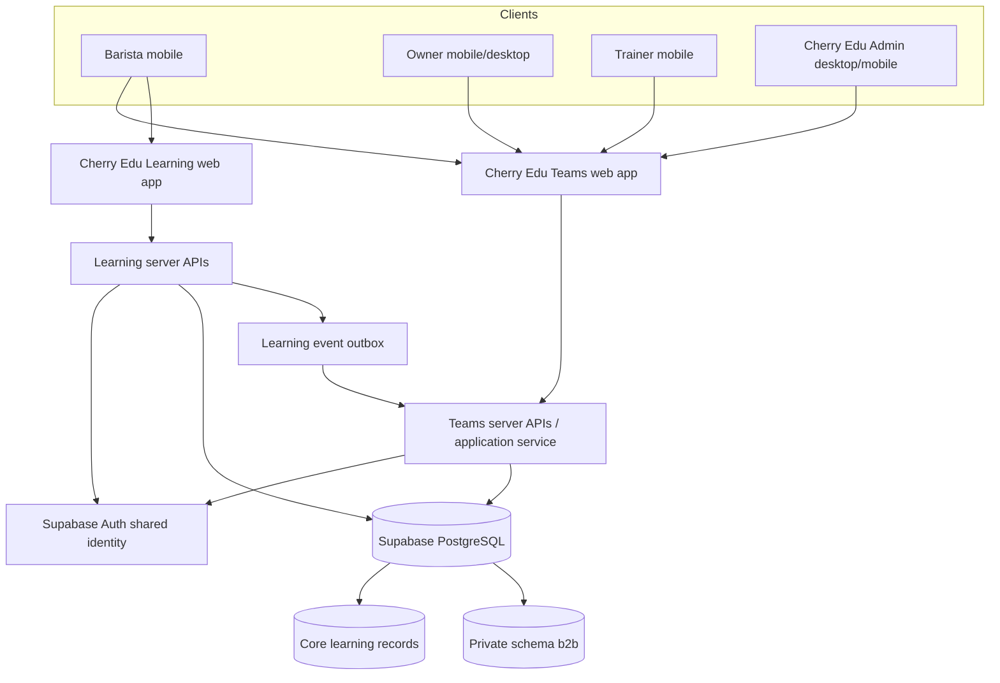
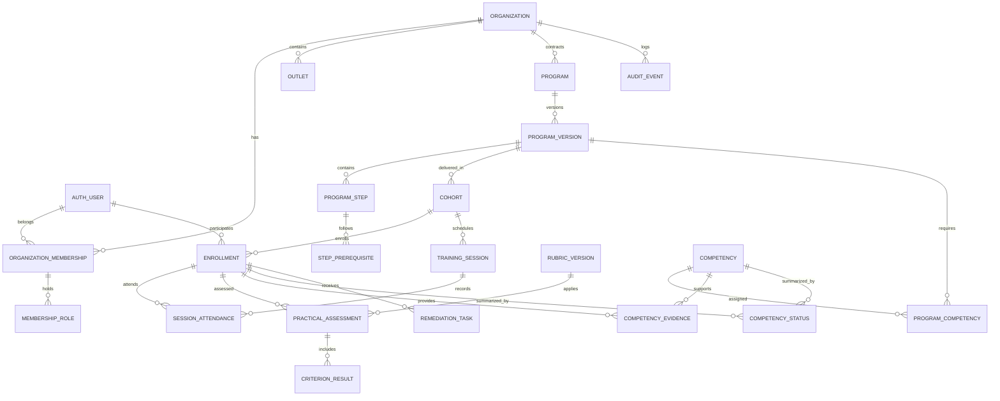
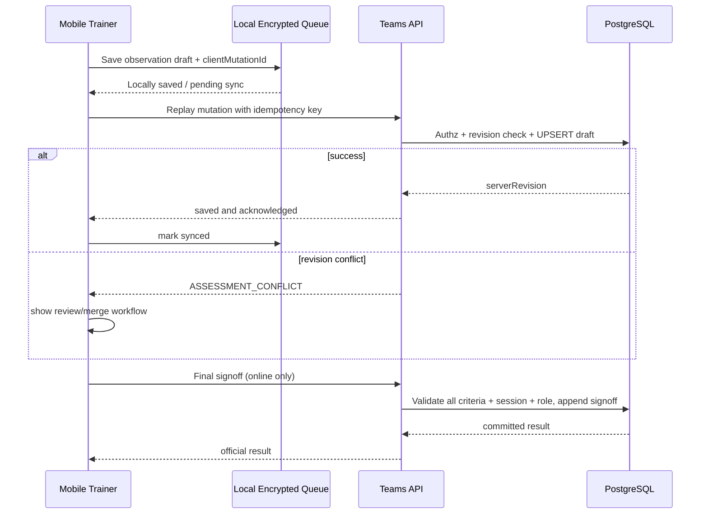

# Cherry Edu Teams — ERD & Technical Architecture v1.0

**Tanggal:** 13 Oktober 2026  
**Status:** Logical/physical design proposal — **belum diimplementasikan**  
**Existing system:** `hallogroup-hq/cherryedu` + Supabase project `cherryedu`  
**Target:** Next.js Teams application, common Supabase Auth, private `b2b` schema, server-based integration.

> **CATATAN KRITIS**: Jangan menjalankan migrasi ini ke project Supabase production saat ini. RLS/grants `public.profiles`/`public.transactions` masih bermasalah dan tabel canonical learning progress belum terlihat pada database live yang diperiksa. Hardening + progress persistence harus diselesaikan dan diverifikasi lebih dulu.

## 1. Keputusan topologi



**Clarification**: Diagram menunjukkan boundary logis; Auth/DB bukan layanan database berbeda. Repo/deployment aplikasi terpisah. `b2b` schema tidak otomatis terekspos Data API; akses sensitif melalui authenticated server API dan otorisasi yang eksplisit.

### 1.1 Kenapa satu database pada tahap awal

- Identitas user yang sama lintas dua aplikasi; FK ke `auth.users` dapat dijaga tanpa replikasi data.
- Tidak memerlukan ETL antar database hanya untuk user mapping.
- Organisasi berbeda tetap harus diisolasi dengan RLS + GRANT + server access checks.
- Fleksibel diekstraksi menjadi proyek/database sendiri jika skala atau kewajiban klien mengharuskan (gunakan stable IDs dan APIs).

### 1.2 Ownership boundary

| Domain | Source of truth | Read from |
|---|---|---|
| Auth identity | Supabase Auth | Kedua aplikasi |
| Public/user profile dasar | Cherry Edu Learning core | B2B berdasarkan scopes |
| B2C subscription | Learning/B2C | Jangan dijadikan B2B permission |
| Learning path, lesson, quiz definition | Learning content service | Teams via read-only published version APIs |
| Canonical lesson progress, quiz attempts | Learning persistence service (to be built/migrated) | Teams via authorized event/read APIs |
| Organization/membership/invite | Teams/B2B | Teams |
| Training program/version/cohort | Teams/B2B | Teams |
| Offline session, attendance, practical assessment | Teams/B2B | Teams |
| Competency signoff | Teams/B2B | Teams + owner scoped reads |
| Content entitlement B2B | Teams + Learning authorization contract | Checked by Learning on delivery |

**Do not:** trust localStorage as authoritative; allow Teams to upsert into every Learning table; grant organization membership via self-editable JWT metadata; copy lesson HTML arbitrarily into customer schema.

## 2. Entity relationship overview



Diagram disederhanakan agar terbaca. Entitas support, invite, roles scoped, outbox, dan FK lintas schema dijabarkan di tabel berikut.

## 3. Proposed schema `b2b` (detailed)

### 3.1 Organizations & identities

#### `b2b.organizations`
- `id uuid pk`
- `slug citext unique not null` (immutable setelah aktivasi kecuali administrative migration)
- `display_name text not null`, `legal_name text nullable`
- `business_category text`, `status text check in (setup, active, suspended, closed)`
- `primary_contact_user_id uuid null references auth.users(id)`
- `timezone text default 'Asia/Jakarta'`
- `created_at timestamptz`, `updated_at timestamptz`, `closed_at timestamptz null`

#### `b2b.outlets`
- `id uuid pk`, `organization_id uuid not null fk organizations`
- `name text`, `city text`, `address text nullable`, `status active/inactive`
- `created_at`, `updated_at`
- `unique(organization_id, id)` to support composite tenant FK.

#### `b2b.organization_memberships`
- `id uuid pk`, `organization_id uuid not null`, `user_id uuid not null references auth.users(id)`
- `status invited/active/suspended/ended`, `joined_at`, `ended_at`, `created_at`
- `unique(organization_id, user_id)` for one membership per organization (re-entry reactivates with history)
- `unique(organization_id, id)` for tenant-scoped composite FKs
- Membership does **not** hold global platform-admin privileges.

#### `b2b.membership_roles`
- `id uuid pk`, `membership_id uuid fk memberships`, `role_code owner/client_manager/head_bar/learner`
- `unique(membership_id, role_code)`
- Strongly prefer permission checks, not binary role comparisons throughout the code.

#### `b2b.membership_outlet_scopes`
- `membership_id uuid`, `organization_id uuid`, `outlet_id uuid`, `primary key(membership_id, outlet_id)`
- Composite organization FK must ensure outlet and membership belong to the same organization.
- If no outlet scopes and role is owner, effective scope can be org-wide by explicit policy; no ambiguous implicit wildcard for regular manager.

#### `b2b.internal_staff_permissions`
- `user_id uuid` (Cherry Edu internal only; granted by a protected admin workflow)
- `permission_code text` e.g. `platform_admin`, `program_admin`, `assessment_quality_reviewer`
- `created_by`, `created_at`, `revoked_at`; `unique(user_id, permission_code, revoked_at)` subject to implementation review.
- Internal roles may apply globally but must be audited and never populated from front-end metadata.

#### `b2b.invitations`
- `id uuid pk`, `organization_id uuid not null`, `email_normalized citext not null`, `intended_role text`, `outlet_id uuid null`
- `token_hash text not null`, `expires_at timestamptz`, `status pending/accepted/expired/revoked`
- `accepted_user_id uuid null`, `invited_by uuid`, `accepted_at`, `created_at`
- Invite token plaintext only present in invitation URL; store hash and avoid logs.
- Partial unique pending invite by org/email/role only if it will not block re-invite after revoke.

### 3.2 Program composition & versions

#### `b2b.program_templates`
- `id uuid pk`, `owner_type cherry|organization`, `owner_organization_id nullable`, `title`, `category`, `status`
- `created_by`, `created_at`

#### `b2b.template_versions`
- `id uuid pk`, `template_id uuid fk`, `version_no integer`, `definition_snapshot jsonb`, `published_at`, `checksum`
- `unique(template_id, version_no)`, immutable after publish.

#### `b2b.programs`
- `id uuid pk`, `organization_id uuid not null`, `title`, `description`, `source_template_id null`
- `status setup/active/ended/archived`, `created_by`, `created_at`
- `unique(organization_id, id)`

#### `b2b.program_versions`
- `id uuid pk`, `program_id uuid not null`, `organization_id uuid not null`, `version_no int`, `status building/published/retired`
- `published_at`, `policy_snapshot jsonb` (grading, attempts, gate policy), `content_checksum`
- `unique(program_id, version_no)`; `program_id + organization_id` composite FK.
- On publish, rules frozen. Enrollment attaches version explicitly.

#### `b2b.program_steps`
- `id uuid pk`, `program_version_id uuid fk`, `organization_id uuid not null`
- `step_type lesson|quiz|practice|session|task|reference|signoff`
- `source_type cherry_learning|b2b_content|practical|external_link`, `source_ref text nullable`, `source_version text nullable`
- `title_override text null`, `sort_order int`, `is_required boolean`, `estimated_minutes int null`
- `gate_policy jsonb` validated with typed schema, `status`
- `unique(program_version_id, sort_order)` where appropriate; stable UUID anchors.

#### `b2b.step_prerequisites`
- `program_version_id`, `step_id`, `requires_step_id`, `rule all|any|approved`
- `primary key(step_id, requires_step_id)`
- Both steps must belong to same program_version; check cycles on publish (SQL recursive query or service DAG validation + transaction lock).

#### `b2b.b2b_content`
- `id uuid pk`, `organization_id uuid nullable`, `visibility internal|org_only`, `content_type text|image|attachment|interactive`
- `title`, `status building/published/retired`, `created_by`, `created_at`
- Immutable `b2b_content_versions` with text blocks + asset references; owner-specific SOP never globally public.

### 3.3 Cohorts, enrollment & learning

#### `b2b.cohorts`
- `id uuid pk`, `organization_id uuid`, `program_version_id uuid`, `name`, `start_at`, `end_at nullable`
- `status scheduled/active/completed/cancelled`, `created_at`
- Composite checks enforce cohort program version belongs to organization.

#### `b2b.enrollments`
- `id uuid pk`, `organization_id uuid`, `cohort_id uuid`, `user_id uuid references auth.users(id)`
- `status invited/active/paused/completed/withdrawn`, `enrolled_at`, `ended_at`
- `unique(cohort_id, user_id)`; `unique(organization_id, id)`
- `source_diagnostic_id nullable`; baseline and exemptions are separate auditable evidence records.

#### `b2b.learning_step_progress`
- `id uuid pk`, `organization_id uuid`, `enrollment_id uuid`, `program_step_id uuid`
- `state not_started/in_progress/completed/blocked`, `last_learning_event_id text null`, `completed_at null`
- `unique(enrollment_id, program_step_id)`
- Derived from verified canonical learning events or verified internal steps; never client-created grade.

#### `b2b.learning_event_receipts`
- `event_id uuid/text pk` assigned by Learning, `organization_id`, `enrollment_id`, `source_content_id`, `event_type`
- `payload_hash`, `received_at`, `processed_at`, `processing_state`, `error_code`.
- Event must carry proof from trusted Learning server, not arbitrary browser requests.
- Reprocessing event with same ID must be idempotent; source content IDs+version stable.

#### `b2b.content_entitlements`
- `id uuid pk`, `organization_id uuid`, `program_version_id uuid`, `source_content_id text`, `source_version text nullable`
- `valid_from`, `valid_until`, `scope assigned_enrollees_only`
- Learning API resolves requester identity+enrollment+entitlement before serving restricted content. Do not just set `profiles.is_pro=true`.

### 3.4 Skill framework, rubrics & assessments

#### `b2b.competencies`
- `id uuid pk`, `organization_id nullable` (null = global library), `code`, `name`, `description`, `source_standard_ref nullable`
- `criticality normal|critical`, `status active/retired`; unique code within owner scope.

#### `b2b.program_competencies`
- `program_version_id`, `competency_id`, `is_required`, `target_level`, `required_evidence_policy jsonb`
- `primary key(program_version_id, competency_id)`

#### `b2b.rubrics`
- `id uuid pk`, `competency_id`, `title`, `created_by`

#### `b2b.rubric_versions`
- `id uuid pk`, `rubric_id`, `version_no`, `status building/published/retired`, `published_at`
- `criterion_definitions jsonb` OR normalized `rubric_criteria` (preferred normalized for reporting)
- Published versions immutable; unique `(rubric_id, version_no)`.

#### `b2b.rubric_criteria`
- `id uuid pk`, `rubric_version_id uuid`, `code text`, `description text`, `weight numeric`, `is_critical boolean`
- `anchors jsonb` explicit descriptions for level 1..4, not just numbers.
- `unique(rubric_version_id, code)`.

#### `b2b.practical_assessments`
- `id uuid pk`, `organization_id`, `enrollment_id`, `competency_id`, `rubric_version_id`, `session_id nullable`
- `assessor_user_id uuid`, `status in_progress|submitted|signed_off|voided`
- `attempt_no int`, `started_at`, `submitted_at`, `signed_off_at`, `idempotency_key uuid`
- `unique(organization_id, idempotency_key)` and composite tenant FK to enrollment/session.
- DB never stores fake "official" signoff from unsynced local pending attempts.

#### `b2b.criterion_results`
- `id uuid pk`, `assessment_id uuid`, `criterion_id uuid`, `level smallint check 1..4`, `critical_failure boolean`
- `notes text`, `evidence_asset_id nullable`, `entered_at`
- `unique(assessment_id, criterion_id)`. Validate criterion belongs to selected rubric version.

#### `b2b.assessment_signoffs`
- `id uuid pk`, `assessment_id uuid`, `signoff_revision int`, `decision competent|not_yet_competent|requires_review`
- `signed_by uuid`, `reason text`, `signed_at`, `supersedes_signoff_id nullable`
- Append-only; any correction creates a revision, never silent UPDATE.

#### `b2b.competency_evidence`
- `id uuid pk`, `organization_id`, `enrollment_id`, `competency_id`, `evidence_type theory_attempt|practice_signoff|diagnostic|exemption|remedial_review`
- `source_record_ref uuid/text`, `rubric_version_id nullable`, `recorded_at`, `valid_until nullable`
- `verification_status verified|superseded|revoked`; derived from trusted records, not learner clicks.

#### `b2b.competency_status`
- `organization_id`, `enrollment_id`, `competency_id`, `state`, `verified_at`, `next_review_at`, `last_recomputed_at`, `derivation_revision`
- `primary key(enrollment_id, competency_id)`; can be a materialized projection maintained from evidence.
- `competent` never manually written without trusted evidence; status and pass explanation derive from versioned policy.

#### `b2b.remediation_tasks`
- `id uuid pk`, `organization_id`, `enrollment_id`, `competency_id`, `criterion_id nullable`, `assigned_by`, `title`, `instructions`
- `due_at nullable`, `status assigned/in_progress/submitted/verified/cancelled`, `created_at`, `resolved_at`
- Assignment completion does not automatically produce competency signoff.

### 3.5 Training operations

#### `b2b.training_sessions`
- `id uuid pk`, `organization_id`, `cohort_id`, `title`, `start_at timestamptz`, `end_at timestamptz`
- `timezone text` (source local timezone), `location_text`, `status scheduled/rescheduled/completed/cancelled`
- `created_by`, `change_reason nullable`, `created_at`

#### `b2b.trainer_assignments`
- `id uuid pk`, `organization_id`, `cohort_id`, `trainer_user_id`, `role lead|assessor|assistant`, `active_from`, `active_until`
- Only explicitly assigned trainers can see roster/sessions and assess according to granted capability.

#### `b2b.session_attendance`
- `organization_id`, `session_id`, `enrollment_id`, `status present/absent/excused/rescheduled`, `recorded_by`, `recorded_at`
- `primary key(session_id, enrollment_id)`; composite FK ensures same organization/cohort.
- Past attendance corrections audited.

### 3.6 Evidence, notifications, audit, integrations

#### `b2b.private_assets`
- `id uuid`, `organization_id`, `storage_bucket`, `storage_path`, `content_type`, `uploaded_by`, `purpose`, `retention_until`, `created_at`
- No public bucket for client SOP or practical evidence; signed URL tenant-authorized and short-lived.

#### `b2b.notification_jobs`
- `id`, `organization_id`, `recipient_user_id`, `type`, `dedupe_key`, `payload_safe jsonb`, `status`, `scheduled_at`, `sent_at`, `retry_count`
- Emails avoid score/evidence details in preview; rate limits and user notification preferences.

#### `b2b.audit_events`
- `id uuid`, `organization_id nullable` (platform action), `actor_user_id`, `action`, `object_type`, `object_id`, `reason`
- `old_summary jsonb`, `new_summary jsonb` (redacted), `occurred_at timestamptz`, `request_id`.
- Append-only privileges. Do not store invite token, JWT, raw answer key, sensitive full field dumps.

#### `b2b.integration_outbox`
- `event_id uuid pk`, `aggregate_type`, `aggregate_id`, `event_type`, `payload_safe`, `created_at`, `delivered_at`, `retry_count`, `last_error_code`
- Worker guarantees at-least-once; consumers idempotent.

## 4. Access control model

### 4.1 Authorization sequence

1. Authenticate requester via supported server-side Supabase Auth; verify user session/claims.
2. Resolve active membership or internal staff grant from trusted DB; reject inactive membership.
3. Resolve tenant scope *from authenticated membership*; tenant supplied by URL is only a requested selector.
4. Resolve outlet / program / cohort assignment scope.
5. Validate action permission on target object.
6. Query/update via tenant-bound conditions and DB RLS or tightly scoped privileged service; log sensitive action.
7. Response excludes private fields and other tenants.

**Never:** `WHERE org_id = body.org_id` without verifying membership; trust `user_metadata.role`; expose secret/service role key to browser.

### 4.2 RLS & schema exposure

- `b2b` remains private by default (not in exposed API schemas). Server handlers enforce scope. If direct Data API access becomes necessary, expose a narrowly controlled `api` schema or specific tables/views with explicit GRANT + RLS, `security_invoker` views as supported.
- Defense in depth on all tenant tables; `USING` and `WITH CHECK` for UPDATE; restrict `INSERT`, `DELETE` where appropriate.
- Tenant child tables use composite FK `(organization_id, parent_id)` referencing parent `(organization_id, id)` to prevent cross-tenant references even when application bug exists.
- Owner reads restricted to organization and assigned outlets; trainer reads to explicit cohorts/participants.
- URL slug never serves as authorization; slug used for routing/lookup after auth.
- Platform administrative operations require audited grants, elevated permissions, and review.

### 4.3 Minimum security test matrix

| Actor | Own records | Same organization other barista | Other organization | Global admin action |
|---|---|---|---|---|
| Learner A | Read assigned own | Denied | Denied | Denied |
| Owner A | Read team program scope | Read authorized scoped records | Denied | Denied |
| Trainer A assigned | Read assigned cohort | Read assigned cohort | Denied outside assignment | Denied |
| Owner B | Read own tenant | Denied to A | Denied | Denied |
| Platform admin (explicit) | Authorized limited access | Authorized + audited | Authorized + audited | Permission-specific |
| Anonymous | Denied private | Denied | Denied | Denied |

Test GET/LIST/UPDATE/CREATE/EXPORT/FILE/SIGNED_URL/webhook/realtime separately. Negative API tests are mandatory: 403/404 with no side-channel record existence disclosure.

## 5. Event contracts & integration

### 5.1 Core learning event shape (illustrative)

```json
{
  "event_id": "<uuid>",
  "event_type": "learning.lesson_completed",
  "schema_version": 1,
  "occurred_at": "<ISO8601>",
  "learner_user_id": "<auth-user-uuid>",
  "source": "cherryedu-learning",
  "content_id": "<stable-lesson-id>",
  "content_version": "<published-version>",
  "result": { "completed": true }
}
```

`event_id` + source signature/trusted internal channel + learner ID determine validity, **not** request body alone. Teams resolves eligible enrollments and entitlements; one B2C lesson completion may satisfy assigned steps for multiple authorized programs only per specified policy. It must never cross-link to other users.

### 5.2 Example API contracts (proposed route names, not implemented)

- `POST /api/organizations` — admin-only; idempotency key; returns org+default outlet.
- `POST /api/organizations/:orgId/invitations` — scoped admin permission; bulk supported.
- `POST /api/invitations/accept` — authenticated identity; one-time token.
- `POST /api/programs/:id/versions/:v/publish` — validation DAG + policy snapshot, transaction.
- `POST /api/cohorts/:id/enrollments` — idempotent enrollment.
- `GET /api/me/programs` — own assigned, no B2C leakage.
- `GET /api/organizations/:id/overview` — owner/manager scope.
- `POST /api/sessions/:id/attendance` — trainer assigned; optimistic concurrency.
- `PUT /api/assessments/:id/draft` — draft-only, concurrency `expected_revision`.
- `POST /api/assessments/:id/signoff` — verified assessor + online transaction.
- `POST /internal/learning-events` — machine-to-machine authentication; not public browser route.

Response envelope returns semantic error codes, e.g. `INVITE_EXPIRED`, `MEMBERSHIP_INACTIVE`, `ASSESSMENT_CONFLICT`, `PROGRESS_SYNC_PENDING`, not raw SQL traces.

### 5.3 Quiz and exam security

- Client receives only answer options permitted for presentation, not `is_correct` or full answer key.
- Attempt submission validated server-side with secure scoring, randomization as needed, active window and max attempts.
- Idempotency keyed by attempt; audit formal submissions and override.
- Learning service owns quiz result; Teams stores trusted reference and eligibility for gate.

## 6. Cross-domain Auth (same identity, not magic shared session)

Using one Supabase Auth project permits the same user ID and credentials. **It does NOT guarantee seamless browser session between independently hosted origins**.

Recommended MVP: both apps support Google/email login against same Auth project; authenticated deep links redirect to intended lesson after auth; preserve `next` only from approved paths. Consider hardened SSO between subdomains only after prototype + security review of cookies, CSRF, OAuth state, session fixation, logout and callback trust. Do not send access/refresh tokens through query strings or unsafe `postMessage`.

## 7. Legacy B2C progress migration — safe strategy

1. Inventory every source of truth: current localStorage keys, seed/demo data, profile Supabase, admin user flows, quiz attempts, certificates.
2. Build server progress schema and auth-scoped endpoints in development/staging; verify every update is identity-owned and monotonic where appropriate.
3. Client opt-in migration on first authorized session; capture local snapshot plus device import ID and checksum. **Unverified local data is not trusted for formal B2B assessment/competency**.
4. Distinguish `historical_imported` and `server_verified` progress; devise verification strategy for existing quiz results/certificates (avoid assigning official status from arbitrary localStorage).
5. Deduplicate by `(user_id, content_id, version, event_type, idempotency_key)`; conflict rules preserve latest validated server state and never downgrade completion due to stale browser state.
6. Provide restore/rollback and audit; do not wipe browser local data until user migration verification confirms.
7. Ship metrics: migrated users, checksum collisions, unresolved conflicts, failed sync, device parity.
8. Prove same user's progress survives logout/login on two devices with account linking, and B2B receives correct results from canonical store.

**Blocking decision:** don't ingest existing local quiz score as trustworthy company performance without validation; otherwise owner dashboard can report invented or manipulated results.

## 8. Program versioning and change policies

- Published template version immutable.
- Published program version immutable; cohort is pinned to program version.
- Rubric version pinned to practical assessment.
- Content update: linked `source_content_version` with allowed revision policy; changes that affect assessment require program revision.
- Evidence signed-off append-only; amendments supersede, audit retained.
- For cohort migration to v2, admin runs explicit migration plan and preview with unaffected/completed/blocked steps; record migration event.

## 9. Offline/sync logic

For trainer drafts only:



Browser storage may not guarantee secure encrypted-at-rest on all devices; choose cache mechanism after threat modeling, minimize private evidence offline, set TTL, clear on deactivation/logout, and never queue formal final exam answers for offline grading in MVP.

## 10. Query/index strategy

Suggested indexes:
- `organization_memberships (user_id, status, organization_id)`.
- `outlets (organization_id, status)`.
- `programs (organization_id, status)`.
- `program_versions (program_id, version_no)` UNIQUE.
- `cohorts (organization_id, program_version_id, status)`.
- `enrollments (organization_id, cohort_id, user_id)` UNIQUE for active cohort assignment as specified.
- `learning_step_progress (enrollment_id, program_step_id)` UNIQUE.
- `practical_assessments (organization_id, enrollment_id, competency_id, submitted_at)`.
- `competency_evidence (organization_id, enrollment_id, competency_id, recorded_at)`.
- `competency_status (organization_id, enrollment_id, state)`.
- `training_sessions (organization_id, start_at, status)`.
- `audit_events (organization_id, occurred_at DESC)`.
- `invitations (organization_id, email_normalized, status)` with thoughtful retention.

All frequently accessed tenant tables have `organization_id`, not only a join buried four levels up. FK/constraints should guarantee same-tenant parent-child relationships.

## 11. Security release gates

**Gate S0 (mandatory):** fix current permissive `public.profiles` + `public.transactions` GRANT/RLS; inspect if PII/transaction fields were exposed; investigate privileged function permissions and leaked password protection; remove/disable frontend demo privilege paths in production. Changes need safe rollout & regression so existing signup/payment doesn't break.

**Gate S1:** RLS, API auth, tenant FK and storage; access matrix negative suite; test admin escalation, IDOR, provider spoofing, CSV and file URLs.

**Gate S2:** learning progress real server storage, quiz answer protection, callback redirects and idempotent integration.

**Gate S3:** backups/restore, monitoring, retention, privacy, incident plan and human approval.

## 12. QA database invariants (must assert)

- Same user may join 2 organizations; no data from organization A leaks to B.
- `organization_id` in every assessment and evidence record matches enrollment's organization.
- Cohort's program version belongs to the cohort's organization.
- Session attendance enrollment belongs to session's cohort and organization.
- Assessment criterion belongs to its rubric version.
- Only an assigned authorized assessor can sign off.
- `competent` status requires approved and applicable evidence, not just user progress rows.
- A program version cannot change its assessment rules after published.
- An event_id cannot increase attempt count twice.
- Invite cannot be accepted twice or after revoked/expired.
- Changing owner/trainer membership revokes associated data access.
- Data removal/export respects tenant and personal boundaries.
- Unexpected event failures route into retry/dead-letter queue and dashboards, not discarded silently.

## 13. Rollout and migration plan

1. **Read-only discovery:** confirm production table inventory, grants, RLS, auth and actual app behavior; no direct changes.
2. **Security remediation branch:** tests → patch dev → staging → owner approval → production with rollback and monitoring.
3. **Learning persistence:** canonical schema/api; migrate and test with consenting/test users; validate old progress.
4. **Teams repo:** scaffold independently, shared brand assets/tokens but no copied unsafe auth patterns.
5. **B2B private schema:** migrations on staging; permission/scoping tests; data seed in isolated staging only.
6. **Product pilot:** 2–3 organizations, real workflows, staged invites; supervised launch.
7. **Release:** feature flags, monitoring, incident owner, backup restore tested, no temporary copy or placeholders in user experience.

## 14. Decisions and trade-offs

| Decision | Chosen for v1 | Revisit trigger |
|---|---|---|
| Database | Shared project, private schema | Legal isolation, load, blast radius or compliance |
| Auth | Shared identity | Cross-subdomain login friction |
| API | Server-mediated authorization | Security/perf evidence for narrower direct RLS reads |
| Tenant | Shared database, row-level isolation | Dedicated enterprise tenancy |
| Device | PWA first | Validated native-only need |
| Offline | Read cache + trainer local drafts | Demand for full offline field assessment |
| Quiz | Server validated | Advanced invigilation / question banks |
| Skill result | Evidence-driven rules | Validated, interpretable advanced models |

## 15. Technical reference links

- https://supabase.com/docs/guides/api/securing-your-api
- https://supabase.com/docs/guides/database/postgres/row-level-security
- https://supabase.com/docs/guides/auth/server-side/creating-a-client
- https://supabase.com/docs/guides/api/using-custom-schemas
- https://www.postgresql.org/docs/current/ddl-schemas.html
- https://www.w3.org/TR/WCAG22/
- https://jdih.kemnaker.go.id/peraturan/detail/2345/keputusan-menteri-ketenagakerjaan-nomor-32-tahun-2023

**Status:** arsitektur logis, ERD dan kontrak konseptual telah dirumuskan; DDL production, migration files, secrets, deploy, dan tenant real **belum dilakukan**.
